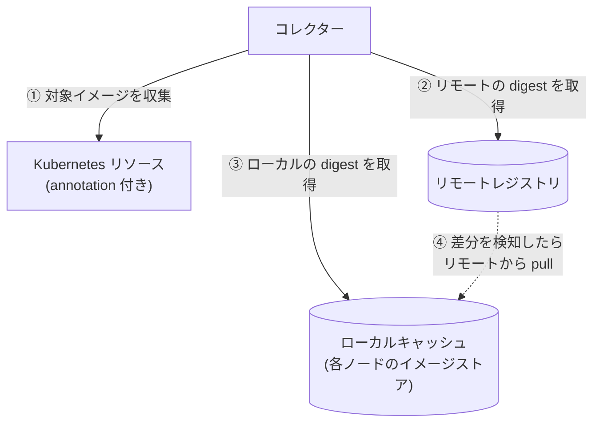
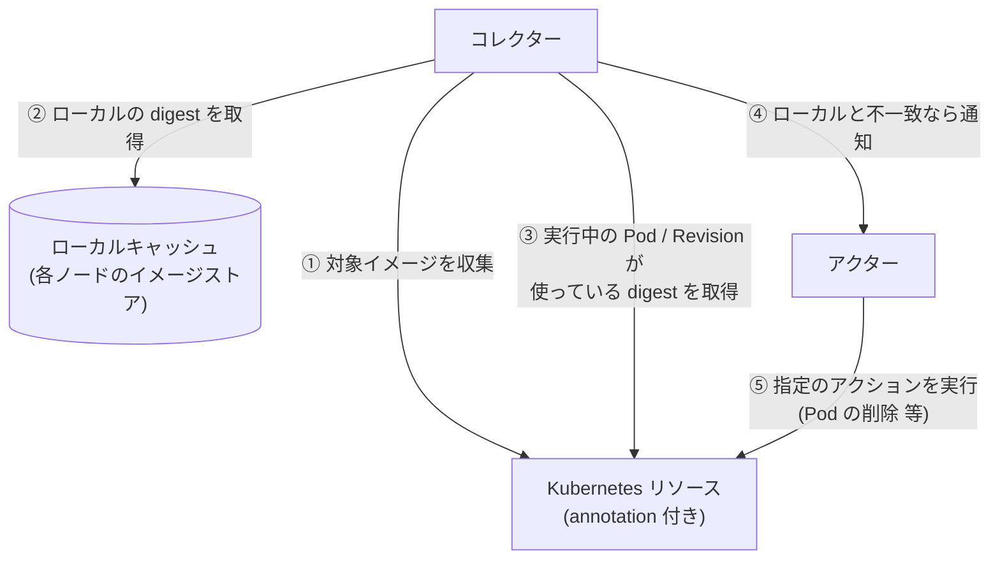

# kube-floatingtag-pinner

`latest` などの可変タグ（floating tag）が指す実体（digest）を追跡し、変化を検知して、
新しいイメージで動かし直すための仕組み。ラフスケッチ段階（詳細は [IDEA.md](./IDEA.md)）。

## 何を解決するか

- `image: xxx:latest` のままだと、レジストリ側が更新されても Kubernetes 側の spec は変わらず、
  新しいイメージが使われない（Knative は Revision 作成時に digest を固定するため特に顕著）。
- Deployment でも、Pod ごとに起動時期で digest がずれうる。
- そこで「タグが今どの digest を指しているか」を記録し、変わったら検知・反映する。

## 提供する機能

| 段階 | 機能 |
| --- | --- |
| 第一段階 | リモートを正に、ローカルキャッシュを同期する（収集・差分検知・pull。ワークロードは変更しない） |
| 第二段階 | ローカルキャッシュを正に、実行中のものが古ければ、指定のアクションを実行して追従させる（ベストエフォート。組み込みは再デプロイにつながるもの。spec の image は書き換えない） |

### 登場人物

| 名前 | 役割 | 第一段階 | 第二段階 |
| --- | --- | :---: | :---: |
| リモートレジストリ | タグ → digest の正本（Docker Hub など） | ○ | |
| ローカルキャッシュ | Kubernetes が pull して各ノードに保持しているイメージ（containerd 等のイメージストア）。Harbor のようなレジストリを建てるものではない。同期先に任意のレジストリを使う形も将来は想定 | ○ | ○ |
| Kubernetes リソース | 所定の annotation が付いた Deployment / StatefulSet / DaemonSet / Knative Service。参照元 | ○ | ○ |
| コレクター | 第一段階: リソースからイメージを収集し、リモートレジストリとローカルキャッシュを比較、差分があれば pull。第二段階: ローカルキャッシュの digest と、実行中の Pod / Revision の digest を比較し、差分を検知 | ○ | ○ |
| アクター（Actor） | 検知した差分に対して、リソースの annotation で指定されたアクション（Action）を実行する。組み込みは再デプロイにつながるもの（Deployment 等は Pod の削除や再ロールアウト、Knative は新 Revision の作成）。`none` は検知とログだけ | | ○ |

> 第二段階ではリモートレジストリとの直接のやり取りは行わない。ローカルキャッシュの digest と、実行中の Pod の `imageID`（Knative は Revision の `imageDigest`）を比べ、不一致ならアクションを実行する。
> spec の image は書き換えない。

## 概要図

### 第一段階: 収集と差分検知（リモートとローカルの同期）

**リモートレジストリを正**にして、**ローカルキャッシュ**（各ノードのイメージストア）を同期する段階。
比べるのは、リモートの `latest` などのフローティングタグが指す digest と、ローカルの同じタグが指す digest。
差分があれば、リモートの内容でローカルを更新する（pull）。Kubernetes のリソースは、どのイメージを対象にするかを知るためだけに読み、
リソースが使っている digest は見ない。リソースには何もしない。



### 第二段階: 反映（ローカルとリソースの同期）

**ローカルキャッシュを正**にして、**Kubernetes のリソース**を同期する段階。第一段階でローカルは最新になっているので、
リモートレジストリは登場しない。比べるのは、ローカルのタグが指す digest と、実行中の Pod（Knative は Revision）が実際に使っている digest。
不一致なら、そのリソースに指定されたアクションを実行する。核は「リソースがローカルより古いことの検知」で、何をするかはアクション次第。
組み込みは、再デプロイにつながるもの（Pod の削除、Knative は新しい Revision の作成など）。spec の image は書き換えない。

各リソースが実際にどのイメージで起動するかは **ベストエフォート**で、Kubernetes の pull の仕組みの結果に任せる。
このツールは、アクション（組み込みは再デプロイ）で pull が起こるきっかけを作るだけで、起動するイメージを指定も保証もしない。
（再デプロイの間にリモートが進めば、ローカルより新しいイメージで起動することもある。）



## 動作の流れ（第一段階）

1. コレクターが実行され、所定の annotation が付いたリソースを列挙し、使っているイメージのうちフローティングタグ
   （既定は `latest`。タグ無しも `latest` 扱い）のものを集める。固定タグ（`v1.2.3` など）と digest 指定は無視する。
2. 各イメージについて、リモートレジストリでの、そのタグの現在の digest を取得する（イメージ本体は落とさない）。
3. ローカルキャッシュ（各ノードのイメージストア）で、同じタグが指している digest を取得して比較する。
   ノードに digest だけがあってタグが付いていないものは見ない（使われるときに勝手に pull されるため）。
   - ローカルのタグがリモートの digest を指している: 変化なし。
   - ローカルのタグが他の digest を指している（ノードごとに食い違う場合を含む）: 差分として検知し、
     リモートのタグを正としてローカルキャッシュを同期する（タグ指定で pull）。
   - ローカルがそのタグを持っていない（初見）: `--on-new` に従う。`register` は pull、`ignore` は何もしない。

digest を別に記録することはしない（正本はリモートのレジストリ、状態はローカルキャッシュ自身が持つ）。
実行中の Pod との突き合わせとアクションの実行は、第二段階で行う。

## コマンド（仮）

コマンドは段階ごとに分ける（段階ごとにリスクと必要な権限が違い、動かす間隔も別にできるため）。名前は仮で、再考の余地がある。

| コマンド | 内容 | 状態 |
| --- | --- | --- |
| `pinner pull` | 第一段階: リモートで変わったイメージを、ローカルキャッシュに pull する | 実装済み |
| `pinner trigger` | 第二段階: ローカルを正に、実行中のものが古ければ、指定のアクションを引き起こす（結果はアクション次第で、保証しない） | 未実装 |
| `pinner sync` | `pull` → `trigger` を続けて行う | 未実装 |

どのコマンドも、既定は 1 回実行して終了。`--daemon`（と `--interval`）で常駐して繰り返す。
第二段階はアクション（Pod の削除など）の実行を伴うので、`pull` だけでは動かない。第二段階まで行うときは、`trigger` か `sync` を明示する。
アクションは、リソースの annotation `floatingtag-pinner/action` で指定する。未指定は `none`（検知とログだけ）で、何も変更しない。

## インストール

手元で動かす想定（クラスタの中で動かす構成は、まだ考えていない）。

- 必要なもの: Go（`go.mod` の版）、対象クラスタに届く `kubeconfig`。
- 権限: Node の list、対象リソース（Deployment など）の list、`--pull-namespace` での Pod の create / get / delete。
  手元の `kubeconfig` が管理者権限なら、追加の設定は要らない。

```sh
git clone https://github.com/sasano8/kube-floatingtag-pinner && cd kube-floatingtag-pinner
go build -o pinner ./cmd/pinner     # ./pinner pull ... で実行できる
# または、ビルドせずに: go run ./cmd/pinner pull ...
```

CI が、`main` への push で `ghcr.io/sasano8/kube-floatingtag-pinner`（amd64 / arm64）のイメージを公開する。
ただし、このイメージでの実行は試していない。

## 実行手順の例（`app-authorization-demo` で確かめる）

1. 対象にする。Knative Service に annotation を付ける（`metadata.annotations`。`spec.template` ではない。
   template を変えると新しい Revision ができてしまう）。

   ```sh
   kubectl annotate ksvc app-authorization-demo -n app-authorization-demo floatingtag-pinner/enabled=true
   ```

   Argo CD の selfHeal で戻されるなら、マニフェスト側にも同じ annotation を書く。

2. **ドライランで見る**（何も pull しない。リモートとローカルを読むだけ）。

   ```sh
   ./pinner pull --dry-run --namespace app-authorization-demo
   ```

   `changed (dry-run: would pull)` と出れば、ローカルのタグが古い。リモートの digest（`remote=`）と、ローカル（`local=`）を見比べる。

3. 実際に pull する。

   ```sh
   ./pinner pull --namespace app-authorization-demo
   ```

4. ローカルのタグが新しくなったか確かめる。

   ```sh
   kubectl get nodes -o json | jq -r '.items[] | .metadata.name as $n | .status.images[]
     | select(any(.names[]; contains("app-authorization-demo"))) | "\($n)\t\(.names | join(" "))"'
   crane digest ghcr.io/sasano8/app-authorization-demo:latest     # リモートの digest
   ```

   `repo:latest` と同じエントリに、リモートの digest（`repo@sha256:…`）が載っていれば成功。
   もう一度 `pull` を実行すると、`unchanged` になる。

## 実行例

```sh
./pinner pull                          # 1回だけ実行して終了（既定）
./pinner pull --dry-run                # 何も pull せず、pull が必要なものだけ報告する
./pinner pull --on-new=ignore          # 初見のイメージは pull せず、差分のあるものだけ同期する
./pinner pull --floating-tags=latest,dev --namespace=tutorial --pull-secret=ghcr-pull
./pinner pull --daemon --interval 5m   # 常駐して、5分ごとに繰り返す

# 第二段階（未実装・予定）
./pinner trigger                       # 第二段階だけ
./pinner sync --daemon                 # pull → trigger を、続けて繰り返す
```

出力は、イメージごとに 1 行のログ（次は形式の例。実クラスタで取った出力ではない）。

```
level=INFO msg=unchanged image=ghcr.io/sasano8/app-authorization-demo:latest owners=[tutorial/Deployment/web] remote=sha256:bf16c8e0… local=[sha256:bf16c8e0…]
level=WARN msg=changed   image=ghcr.io/sasano8/app-authorization-demo:latest owners=[app-authorization-demo/Service/app-authorization-demo] remote=sha256:bf16c8e0… local=[sha256:4a45bcf8…] pulled=true
level=WARN msg="changed (dry-run: would pull)" image=ghcr.io/sasano8/app-authorization-demo:latest owners=[app-authorization-demo/Service/app-authorization-demo] remote=sha256:bf16c8e0… local=[sha256:4a45bcf8…]
level=WARN msg=new       image=docker.io/library/nginx:latest owners=[tutorial/Deployment/proxy] remote=sha256:… local=[] pulled=true
```

- `unchanged`: ローカルのタグがリモートと同じ digest を指している。
- `changed`: ローカルのタグが別の digest を指していた（古い）。リモートの内容で同期した（`pulled=true`）。
- `new`: ローカルがそのタグを持っていなかった。`--on-new=register`（既定）なら pull する。`ignore` なら `ignored` と出して何もしない。
- `(dry-run: would pull)`: `--dry-run` のとき、pull が必要だったもの（pull はしていない）。
- 1 つでも失敗（認証、タイムアウトなど）があると、終了コードは非 0。

| フラグ | 既定値 | 説明 |
| --- | --- | --- |
| `--local` | `node` | ローカルキャッシュの種類。現状は `node`（ノードのイメージストア）のみ |
| `--floating-tags` | `latest` | 追う（フローティング）タグ。カンマ区切り。これ以外のタグは固定とみなして無視。空なら全タグ |
| `--dry-run` | なし | 何も pull せず、pull が必要なものだけ報告する |
| `--on-new` | `register` | ローカルに何も無いイメージの扱い: `register`（pull）/ `ignore` |
| `--pull-namespace` | `default` | pull 用 Pod を作る名前空間 |
| `--pull-secret` | なし | 非公開レジストリ用の imagePullSecret 名（`--pull-namespace` 内） |
| `--pull-timeout` | `2m` | ノードごとの pull の待ち時間 |
| `--daemon` | なし | 常駐して `--interval` ごとに繰り返す。指定しなければ 1 回で終了 |
| `--interval` | `5m` | `--daemon` 時の実行間隔 |
| `--namespace` | 全て | 対象の名前空間 |
| `--annotation` | `floatingtag-pinner/enabled` | 対象を示す annotation（値 `"true"`） |
| `--kubeconfig` | in-cluster → `~/.kube/config` | |

対象は Deployment / StatefulSet / DaemonSet / Knative Service。`--floating-tags` 以外のタグと、`@sha256:` で固定済みのイメージは除く。

現状の制約:

- `node` の pull: Ready な各ノードに、そのノード固定（`nodeName`）の短命な Pod を作り、kubelet にタグ指定（`repo:latest` など、ワークロードと同じ参照）で pull させる。ノード上のタグが新しいイメージに付け替わり、
  あとで `IfNotPresent` の Pod が作られても新しいイメージで起動する。
  Pod のコマンドは存在しないものにしてあり、コンテナは動かない（pull だけが目的）。pull 完了後に Pod は削除する。
  必要な権限: Node の list、`--pull-namespace` での Pod の create / get / delete。
  ワークロードの spec は変更しない。
- ローカルキャッシュの読み取りは、呼ぶたびに Node を取得し直す（再スキャン）。結果をキャッシュして高速化する形は、`Local` を包む形で後から付け替えられる（現状は再スキャンのみ）。
- ノードの状態は `Node.status.images` から読む。kubelet の既定で1ノード最大50件、全ノードの和集合で判定する。

### 構成

```
cmd/pinner/          エントリポイント（段階ごとのコマンド。既定は1回実行、--daemon で常駐）
internal/collector/  収集と比較のロジック（実行形態に依存しない。Source / Registry / Local の interface）
internal/source/     Kubernetes リソースからイメージを集める
internal/registry/   リモートレジストリの digest 取得（go-containerregistry）
internal/local/      ローカルキャッシュ（ノードのイメージストアを読む実装）
```

設計の詳細（なぜそうしているか、採らなかった案、実機で未確認の前提）は [docs/design.md](./docs/design.md)。

## 既存ツールの対応状況

Keel・Knative 本体・Argo CD Image Updater では、ksvc の `latest` 追従を満たせないことを確認している
（Knative 本体は実機で確認）。詳細は [docs/research.md](./docs/research.md)。

## 未決事項

- コマンド名（`pull` / `trigger`）は決定。両方を続けて行う `sync` は仮。
- 第二段階（`trigger`、アクター、アクション）の実装。
- 任意のレジストリを同期先にする `--local`（`registry`）。
- Argo CD の `selfHeal` との折り合い（第二段階の実運用前に確認。[docs/design.md](./docs/design.md) 参照）。
