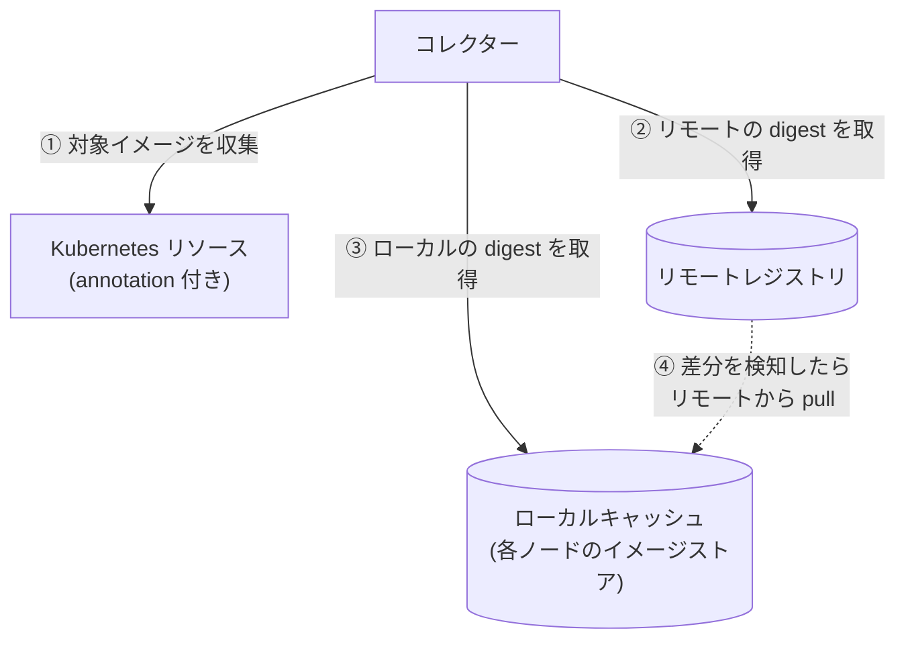
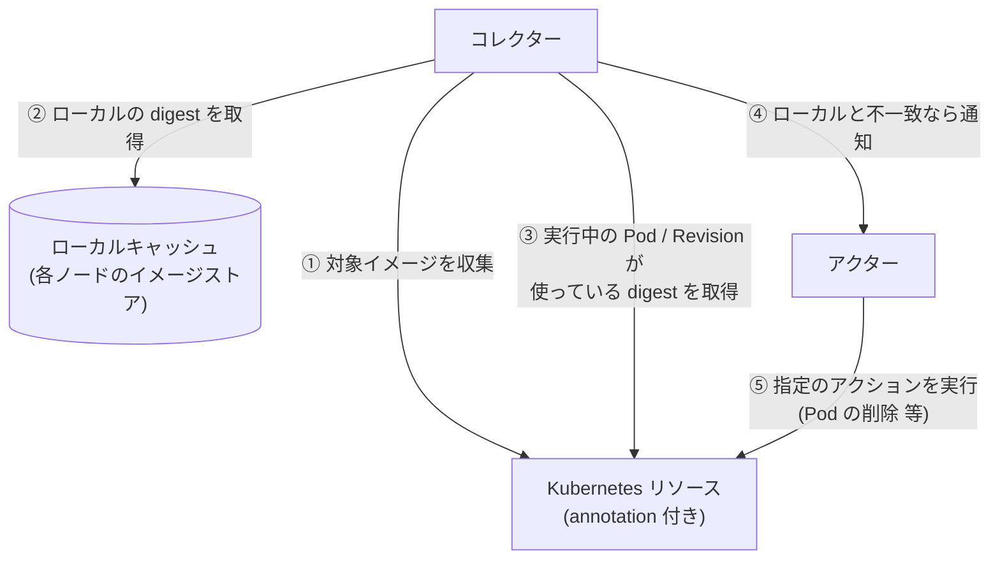

# kube-floatingtag-pinner

`latest` などの可変タグ（floating tag）が指す実体（digest）を追跡し、変化を検知して、
新しいイメージで動かし直すための仕組み。ラフスケッチ段階（詳細は [IDEA.md](./IDEA.md)）。

## 何を解決するか

- `image: xxx:latest` のままだと、レジストリ側が更新されても Kubernetes 側の spec は変わらず、
  新しいイメージが使われない（Knative は Revision 作成時に digest を固定するため特に顕著）。
- Deployment でも、Pod ごとに起動時期で digest がずれうる。
- そこで「タグが今どの digest を指しているか」を記録し、変わったら検知・反映する。

## 提供する機能

| 段階 | 機能 |
| --- | --- |
| 第一段階 | リモートを正に、ローカルキャッシュを同期する（収集・差分検知・pull。ワークロードは変更しない） |
| 第二段階 | ローカルキャッシュを正に、実行中のものが古ければ、指定のアクションを実行して追従させる（ベストエフォート。組み込みは再デプロイにつながるもの。spec の image は書き換えない） |

### 登場人物

| 名前 | 役割 | 第一段階 | 第二段階 |
| --- | --- | :---: | :---: |
| リモートレジストリ | タグ → digest の正本（Docker Hub など） | ○ | |
| ローカルキャッシュ | Kubernetes が pull して各ノードに保持しているイメージ（containerd 等のイメージストア）。Harbor のようなレジストリを建てるものではない。同期先に任意のレジストリを使う形も将来は想定 | ○ | ○ |
| Kubernetes リソース | 所定の annotation が付いた Deployment / StatefulSet / DaemonSet / Knative Service。参照元 | ○ | ○ |
| コレクター | 第一段階: リソースからイメージを収集し、リモートレジストリとローカルキャッシュを比較、差分があれば pull。第二段階: ローカルキャッシュの digest と、実行中の Pod / Revision の digest を比較し、差分を検知 | ○ | ○ |
| アクター（Actor） | 検知した差分に対して、リソースの annotation で指定されたアクション（Action）を実行する。組み込みは再デプロイにつながるもの（Deployment 等は Pod の削除や再ロールアウト、Knative は新 Revision の作成）。`none`（既定）は何もしない（見つけたことはログに出る） | | ○ |

> 第二段階ではリモートレジストリとの直接のやり取りは行わない。ローカルキャッシュの digest と、実行中の Pod の `imageID`（Knative は Revision の `imageDigest`）を比べ、不一致ならアクションを実行する。
> spec の image は書き換えない。

## 概要図

### 第一段階: 収集と差分検知（リモートとローカルの同期）

**リモートレジストリを正**にして、**ローカルキャッシュ**（各ノードのイメージストア）を同期する段階。
比べるのは、リモートの `latest` などのフローティングタグが指す digest と、ローカルの同じタグが指す digest。
差分があれば、リモートの内容でローカルを更新する（pull）。Kubernetes のリソースは、どのイメージを対象にするかを知るためだけに読み、
リソースが使っている digest は見ない。リソースには何もしない。



### 第二段階: 反映（ローカルとリソースの同期）

**ローカルキャッシュを正**にして、**Kubernetes のリソース**を同期する段階。第一段階でローカルは最新になっているので、
リモートレジストリは登場しない。比べるのは、ローカルのタグが指す digest と、実行中の Pod（Knative は Revision）が実際に使っている digest。
違っていれば、そのリソースに指定されたアクションを実行する。核は「リソースがローカルと違うことの検知」で、何をするかはアクション次第。
（違う digest が古いのか新しいのかは分からない。ローカルを正にするのは方針で、新旧の事実ではない。）
組み込みは、再デプロイにつながるもの（Pod の削除、Knative は新しい Revision の作成など）。spec の image は書き換えない。

各リソースが実際にどのイメージで起動するかは **ベストエフォート**で、Kubernetes の pull の仕組みの結果に任せる。
このツールは、アクション（組み込みは再デプロイ）で pull が起こるきっかけを作るだけで、起動するイメージを指定も保証もしない。
（再デプロイの間にリモートが進めば、ローカルより新しいイメージで起動することもある。）



## 動作の流れ（第一段階）

1. コレクターが実行され、所定の annotation が付いたリソースを列挙し、使っているイメージのうちフローティングタグ
   （既定は `latest`。タグ無しも `latest` 扱い）のものを集める。固定タグ（`v1.2.3` など）と digest 指定は無視する。
2. 各イメージについて、リモートレジストリでの、そのタグの現在の digest を取得する（イメージ本体は落とさない）。
3. ローカルキャッシュ（各ノードのイメージストア）で、同じタグが指している digest を取得して比較する。
   ノードに digest だけがあってタグが付いていないものは見ない（使われるときに勝手に pull されるため）。
   - ローカルのタグがリモートの digest を指している: 変化なし。
   - ローカルのタグが他の digest を指している（ノードごとに食い違う場合を含む）: 差分として検知し、
     リモートのタグを正としてローカルキャッシュを同期する（タグ指定で pull）。
   - ローカルがそのタグを持っていない（初見）: `--on-new` に従う。`register` は pull、`ignore` は何もしない。

digest を別に記録することはしない（正本はリモートのレジストリ、状態はローカルキャッシュ自身が持つ）。
実行中の Pod との突き合わせとアクションの実行は、第二段階で行う。

## インストール

手元で動かす想定（クラスタの中で動かす構成は、まだ考えていない）。ビルド済みのバイナリをダウンロードするのが、いちばん簡単。

### 前提

- 対象のクラスタに届く `kubeconfig`（`--kubeconfig`、または `~/.kube/config`）。手元の `kubeconfig` が管理者の権限なら、権限の設定は要らない。
- `kubectl`（annotation を付けたり、動作を確かめたりするため）。
- 必要な権限（管理者でないとき）:

  | コマンド | 権限 |
  | --- | --- |
  | `collect` | 対象リソースの `list`（`apps` の `deployments`、`statefulsets`、`daemonsets`、Knative の `services`） |
  | `pull` | 上記 + `nodes` の `list` + `--pull-namespace` での `pods` の `create` / `get` / `delete` |
  | `trigger` | `collect` と同じ + `nodes` の `list` + `pods` の `list` + Knative の `revisions` の `get`。アクションごとに、`rollout` は対象リソースの `patch`、`delete-pods` は `pods` の `delete` |

### バイナリをダウンロードする

[`latest` の Release](https://github.com/sasano8/kube-floatingtag-pinner/releases/tag/latest) に、`main` の最新から作ったバイナリがある。
`main` に push するたびに、CI が**上書き**する（バージョン番号は付けない）。

| OS | アーキ | ファイル |
| --- | --- | --- |
| Linux | amd64 / arm64 | `pinner_linux_amd64.tar.gz` / `pinner_linux_arm64.tar.gz` |
| macOS | amd64（Intel）/ arm64（Apple Silicon） | `pinner_darwin_amd64.tar.gz` / `pinner_darwin_arm64.tar.gz` |
| Windows | amd64 / arm64 | `pinner_windows_amd64.zip` / `pinner_windows_arm64.zip` |

`checksums.txt` に SHA-256 がある。

**Linux / macOS**

```sh
# gh があれば（Linux の amd64 の例。ファイル名は表から選ぶ）
gh release download latest -R sasano8/kube-floatingtag-pinner -p 'pinner_linux_amd64.tar.gz'
# gh がなければ
curl -fsSLO https://github.com/sasano8/kube-floatingtag-pinner/releases/download/latest/pinner_linux_amd64.tar.gz

tar xzf pinner_linux_amd64.tar.gz     # → ./pinner
sudo mv pinner /usr/local/bin/        # 任意。PATH の通った場所へ
pinner collect --help
```

**macOS だけ**: 署名していないので、初回に「開発元を確認できない」と警告される。`xattr -d com.apple.quarantine pinner` で外せる。

**Windows**（PowerShell）

```powershell
Invoke-WebRequest https://github.com/sasano8/kube-floatingtag-pinner/releases/download/latest/pinner_windows_amd64.zip -OutFile pinner.zip
Expand-Archive pinner.zip -DestinationPath .       # → .\pinner.exe
.\pinner.exe collect --help
```

ブラウザからは、上の Release のページで、自分の OS のファイルを取って、展開する。

### ソースからビルドする

Go（`go.mod` の版）が必要。

```sh
git clone https://github.com/sasano8/kube-floatingtag-pinner && cd kube-floatingtag-pinner
go build -o pinner ./cmd/pinner          # → ./pinner（Windows は pinner.exe）
# ビルドせずに試すなら: go run ./cmd/pinner collect
```

CI は、あわせて `ghcr.io/sasano8/kube-floatingtag-pinner`（amd64 / arm64 のコンテナイメージ。`Dockerfile`）も公開している。ただし、このイメージでの実行は試していない。
認証情報の置き場は、「[非公開レジストリ（認証）](#非公開レジストリ認証)」を参照。

### 動作確認（インストールできたか）

```sh
pinner version              # どのビルドか（コミットと Go のバージョン）。修正前のバイナリを使っていないかの確認にも使う
pinner collect --help       # フラグの一覧が出る
pinner collect              # kubeconfig のクラスタで、annotation の付いたリソースを一覧する（読み取りのみ。何も無ければ、表の見出しだけ）
```

`pinner collect` が、クラスタに届いて、表の見出し（`RESOURCE  IMAGE  TRACKED …`）を出せば、インストールと接続は、できている。

### 対象のイメージが非公開レジストリにあるとき

次の「動作確認の手順」の前に、認証を設定しておく（詳しくは「[非公開レジストリ（認証）](#非公開レジストリ認証)」）。

- **クラスタのノード**（`pull` の Pod が、イメージを pull するため）: ノード側に認証情報を足す。kubelet が読む `config.json` なら、
  `/var/lib/kubelet/config.json` を編集する（置き場所は要確認）。設定の仕方は、公式のドキュメントを参照:
  [Configuring nodes to authenticate to a private registry](https://kubernetes.io/docs/concepts/containers/images/#configuring-nodes-to-authenticate-to-a-private-registry)、
  [kubelet credential provider](https://kubernetes.io/docs/tasks/administer-cluster/kubelet-credential-provider/)。
- **`pinner` が、リモートの digest を問い合わせるとき**: `pull` の `--credential <ファイル>`（docker の `config.json` と同じ形式）。ノードの `config.json` を、そのまま指定してもよい。

公開のイメージなら、何も要らない。認証が足りないと、`collect` / `pull` は `error`（リモートの digest が取れない）、`pull` は `outcome=pull-failed`（ノードの pull が失敗）になる。

## 動作確認の手順（`app-authorization-demo` で確かめる）

1. **対象にする。** Knative Service の `metadata.annotations` に付ける（`spec.template` ではない。テンプレートを変えると、新しい Revision ができてしまう）。

   ```sh
   kubectl annotate ksvc app-authorization-demo -n app-authorization-demo floatingtag-pinner/enabled=true
   ```

2. **集まっているか見る。**

   ```sh
   pinner collect --namespace app-authorization-demo
   ```

   `ghcr.io/sasano8/app-authorization-demo:latest` が `TRACKED` = `yes` で出れば、対象になっている。`no: …` なら、理由が出る。

3. **ドライランで見る**（何も pull しない。リモートとローカルを読むだけ）。

   ```sh
   pinner pull --dry-run --namespace app-authorization-demo
   ```

   `pull mismatch` に `outcome=would-pull` と出れば、ローカルのタグがリモートと違い、pull が必要。`remote=` と `local=` の digest を見比べる。

4. **pull する。**

   ```sh
   pinner pull --namespace app-authorization-demo
   ```

   `pull not-pulled`（または `pull mismatch`、`outcome=pulled`）に続けて `pull match`（`via=pulling`）と出れば、ノードが、リモートの digest を pull できた
   （pull 用 Pod が報告した digest が、リモートと同じ）。

5. **ノードで確かめる。**

   ```sh
   kubectl get nodes -o json | jq -r '.items[] | .metadata.name as $n | .status.images[]
     | select(any(.names[]; contains("app-authorization-demo"))) | "\($n)\t\(.names | join(" "))"'
   crane digest ghcr.io/sasano8/app-authorization-demo:latest     # リモートの digest
   ```

   `repo:latest` と同じエントリに、リモートの digest（`repo@sha256:…`）が載っていれば成功。もう一度 `pinner pull` を実行すると、`pull match` だけになる。
   **ノードの一覧への反映は、数分遅れることがある**（kubelet がイメージの一覧を更新するのが遅い）。載っていなければ、数分待って、もう一度確かめる。

6. **動いているものがローカルと違うかを調べる**（何も変更しない）。

   ```sh
   pinner trigger --namespace app-authorization-demo
   ```

   Revision の digest がローカルのタグと違えば `trigger mismatch`、同じなら `trigger match`。

7. **アクションを試す**（ここからは、リソースが変わる）。まず `--dry-run` で、何が実行されるかを見る。

   ```sh
   kubectl annotate ksvc app-authorization-demo -n app-authorization-demo floatingtag-pinner/on-mismatch=rollout
   pinner trigger --dry-run --namespace app-authorization-demo     # 'would run action ... rollout' と出る
   pinner trigger --namespace app-authorization-demo               # 実行する（新しい Revision ができる）
   kubectl get revision -n app-authorization-demo                  # 新しい Revision が増えている
   pinner trigger --namespace app-authorization-demo               # 新しい Revision なら、trigger match になる
   ```

   途中で、`--max-actions 1` を付けると、1 回の実行で依頼する数を 1 件に抑えられる。

## Deployment での確認（`delete-pods`、`rollout`）

アプリが落ちる（`CrashLoopBackOff`）と、kubelet が再起動するたびに、ノードのタグを拾い直してしまい、`mismatch` が自然に消える
（`delete-pods` を試せない）。そこで、**落ちない専用のイメージ**を使う。`busybox` にラベルを足しただけの 2 つのイメージ（中身は同じで、digest だけが違う）を作り、
タグ `latest` を、その間で付け替えて、「リモートのタグが動いた」状況を作る。

**1. 専用イメージを作る**（`docker login ghcr.io` 済みで、手元が、動かすノードと同じアーキテクチャであること）

```sh
cd "$(mktemp -d)"
for v in v1 v2; do
  printf 'FROM busybox:1.36\nLABEL pinner.test=%s\n' "$v" > Dockerfile
  docker build -q -t ghcr.io/sasano8/pinner-test:$v .
  docker push ghcr.io/sasano8/pinner-test:$v
done
set_latest() { docker tag ghcr.io/sasano8/pinner-test:$1 ghcr.io/sasano8/pinner-test:latest && docker push ghcr.io/sasano8/pinner-test:latest; }
set_latest v1
```

ghcr のパッケージは、初回は private なので、GitHub の Packages → `pinner-test` → Package settings → Change visibility → **Public** にする
（private のままなら、ノード側に認証情報を足す。「非公開レジストリ（認証）」の節を参照）。

**2. Deployment を作る**（`imagePullPolicy: IfNotPresent`。Pod が作り直されたときに、ノードのタグが使われることを確かめるため）

```sh
kubectl create namespace pinner-test
kubectl -n pinner-test create deployment sleeper --image=ghcr.io/sasano8/pinner-test:latest --replicas=2 \
  -- sh -c 'while true; do sleep 60; done'
kubectl -n pinner-test patch deployment sleeper --type=json \
  -p '[{"op":"add","path":"/spec/template/spec/containers/0/imagePullPolicy","value":"IfNotPresent"}]'
kubectl -n pinner-test annotate deployment sleeper floatingtag-pinner/enabled=true
```

**3. 流れ**（ノードの一覧への反映は数分遅れるので、`match` / `mismatch` が期待どおりにならなければ、待ってやり直す。`--debug` で、何を読んだか分かる）

```sh
pinner pull --namespace pinner-test && pinner trigger --namespace pinner-test      # どちらも match
set_latest v2
pinner pull --namespace pinner-test              # pull mismatch → pull match（via=pulling）
pinner trigger --debug --namespace pinner-test   # trigger mismatch（Pod は v1、ローカルは v2）

kubectl -n pinner-test annotate deployment sleeper floatingtag-pinner/on-mismatch=delete-pods
gen=$(kubectl -n pinner-test get deployment sleeper -o jsonpath='{.metadata.generation}')
pinner trigger --dry-run --namespace pinner-test # would run action … delete-pods（何も変わらない）
pinner trigger --namespace pinner-test           # action requested … delete-pods
kubectl -n pinner-test get pods -o jsonpath='{range .items[*]}{.metadata.name}{"\t"}{.status.containerStatuses[0].imageID}{"\n"}{end}'   # 新しい Pod は v2
test "$(kubectl -n pinner-test get deployment sleeper -o jsonpath='{.metadata.generation}')" = "$gen" && echo "generation unchanged"
pinner trigger --namespace pinner-test           # trigger match
```

`rollout` も同じ手順で試せる（`on-mismatch=rollout` にして、`set_latest v1` で付け替え、`pull`、`trigger`。Pod テンプレートに `floatingtag-pinner/restartedAt` が付き、ローリング更新になる）。
片付け: `kubectl delete namespace pinner-test`。

## コマンド（仮）

コマンドは段階ごとに分ける（段階ごとにリスクと必要な権限が違い、動かす間隔も別にできるため）。名前は仮で、再考の余地がある。

| コマンド | 内容 | 状態 |
| --- | --- | --- |
| `pinner collect` | annotation の付いたリソースと、使っているイメージを集めて表示する。**`pull` と `trigger` の土台**（読み取りのみ） | 実装済み |
| `pinner pull` | 第一段階: リモートで変わったイメージを、ローカルキャッシュに pull する | 実装済み |
| `pinner trigger` | 第二段階: ローカルを正に、実行中のものがローカルと違えば、指定のアクションを引き起こす（結果はアクション次第で、保証しない） | 検知と `none` のみ実装済み |
| `pinner sync` | `pull` → `trigger` を続けて行う | 未実装 |

`pull` と `trigger` は、どちらも、`collect` と同じ収集から始まる（annotation の付いたリソースと、そのイメージ）。
そのため、`--kubeconfig`、`--namespace`、`--annotation`、`--floating-tags` は、3 つのコマンドで共通で、`collect` で見えたものが、`pull` と `trigger` の対象になる。
「なぜ、このイメージが対象にならないのか」は、まず `collect` で確かめる。

どのコマンドも、既定は 1 回実行して終了。`--daemon`（と `--interval`）で常駐して繰り返す。
第二段階はアクション（将来は Pod の削除など）の実行を伴うので、`pull` だけでは動かない。第二段階まで行うときは、`trigger` か `sync` を明示する。
アクション（`trigger` がリソースにすること）は、ログ（報告）とは別のもの。

- **ログ**: 見つけたことは、アクションと関係なく、常にすべて報告する。出す範囲は実行時のオプションで絞る（下の「ログ」）。
- **アクション**: リソースに何かをするもの。リソースの annotation で、状態ごとに指定する。**既定は `none`（何もしない）**。
  現状のアクションは `none`（既定）、`rollout`、`delete-pods`。

| アクション | 対象 | 操作 |
| --- | --- | --- |
| `none`（既定） | すべて | 何もしない（見つけたことは、ログに出る） |
| `rollout` | Deployment / StatefulSet / DaemonSet / Knative Service | Pod テンプレート（`spec.template.metadata.annotations`）に `floatingtag-pinner/restartedAt: <時刻>` を足して、新しい世代を出す。Deployment 等ではローリング更新、Knative では新しい Revision（作成時にタグが解決し直される）。**image は変更しない** |
| `delete-pods` | Deployment / StatefulSet / DaemonSet | `mismatch` だった Pod だけを削除する（ReplicaSet 等が作り直し、ローカルのイメージで起動する）。リソース自体には触れない。Knative は対象外（Pod を消しても、Revision が固定した同じ digest で作り直されるだけ）。`on-mismatch` にだけ指定できる |

`rollout` の変更は、field manager `floatingtag-pinner` として記録される（誰が変えたかが、`managedFields` で分かる）。
必要な権限: `rollout` は対象リソース（`deployments`、`statefulsets`、`daemonsets`、Knative の `services`）の `patch`、`delete-pods` は `pods` の `delete`。

`delete-pods` は、違う Pod を**まとめて**削除する（UID を条件にするので、すでに入れ替わった Pod は消さない）。一時的に Pod が足りなくなることがある。
段階的に入れ替えたいときは `rollout`（ローリング更新の strategy に従う）を使う。

例: `kubectl annotate deployment/myapp floatingtag-pinner/on-mismatch=rollout`

| annotation | 意味 | 既定 |
| --- | --- | --- |
| `floatingtag-pinner/on-mismatch` | ローカルと違うときのアクション。**ふつうは、これだけ指定すればよい** | `none` |
| `floatingtag-pinner/on-not-pulled` | ローカルキャッシュがタグを持っていないときのアクション（任意） | `none` |
| `floatingtag-pinner/on-error` | 比較の途中で失敗したときのアクション（任意） | `none` |

- `match` と `not-running` には、アクションを結び付けない。
- `error` は、アクションにかかわらず、終了コードが非 0 になる。
- `on-not-pulled` は `on-mismatch` を引き継がない。比べる相手が無いので、何かを実行し続ける恐れがあるため
  （たとえば Knative は、Revision の Pod が digest で pull するので、ノードにタグが付かず、`not-pulled` のままになりうる）。
- `trigger --dry-run` は、アクションを実行せず、どのアクションが実行されるはずだったかをログに出す。
- 同じ（リソース、イメージ、ローカルの digest）に対して、同じアクションは **1 回しか依頼しない**（`--daemon` で `rollout` を周期ごとに繰り返さないため）。
  依頼の履歴は、ステートストア（いまはメモリ上の辞書）に持つ。プロセスが終わると忘れるので、`trigger` を 1 回実行で繰り返すときは、毎回忘れる。
  失敗や、効かなかったときに消極的にする戦略（`backoff` など）と、永続化は、これから（[docs/design.md](./docs/design.md)）。
  ローカルの digest が変われば、新しい状態として、また依頼する。`--dry-run` の実行は、数えない。
- `trigger --max-actions N` は、1 回の実行で依頼するアクションの数を N 件までにする（既定 0 = 上限なし）。間違えたときの影響を小さくする。

### collect（収集して表示する）

```sh
./pinner collect                       # 表
./pinner collect -o json               # JSON（スクリプト向け）
./pinner collect --namespace tutorial --floating-tags=latest,dev
```

```
RESOURCE                                   IMAGE                                    TRACKED                                       ON-MISMATCH  ON-NOT-PULLED  ON-ERROR
tutorial/Deployment/web                    ghcr.io/sasano8/app-authorization-demo:latest  yes                                     rollout      -              -
tutorial/Deployment/web                    ghcr.io/o/fixed:v1.2.3                   no: tag is not floating (see --floating-tags)  rollout      -              -
tutorial/Deployment/web                    ghcr.io/o/side@sha256:abc…               no: pinned by digest                           rollout      -              -
app-authorization-demo/Service/app-authorization-demo  ghcr.io/sasano8/app-authorization-demo:latest  yes                       -            -              -
```

- 1 行が、（リソース、イメージ）。`TRACKED` が `yes` のものが、`pull` と `trigger` の対象。`no: …` は、対象にならない理由。
- `ON-MISMATCH` などは、リソースの annotation に書かれたアクション（`-` は未指定 = 既定の `none`）。
- annotation `floatingtag-pinner/enabled: "true"` が付いたリソースだけが出る。付いていても、追うイメージが無ければ、すべて `no: …` で出る。
- 何も変更しない。リモートのレジストリにも、ノードにも触れない（クラスタの読み取りだけ）。権限は、対象リソースの `list`。

### ログ

`pull` も `trigger` も、見つけたことを、次の**状態**として報告する。名前は両方で共通。比べる相手だけが違う。

| 状態 | 第一段階（`pull`）: リモート ⇔ ローカル | 第二段階（`trigger`）: ローカル ⇔ 実行中 | ログレベル |
| --- | --- | --- | --- |
| `match` | ローカルのタグがリモートと同じ digest | 実行中の digest がローカルのタグと同じ | INFO |
| `mismatch` | ローカルのタグがリモートと違う digest（新旧は分からない） | 実行中の digest がローカルのタグと違う（新旧は分からない） | WARN |
| `not-pulled` | ローカルがそのタグを持っていない | 同じ | WARN |
| `not-running` | （なし） | 比べる相手（実行中の Pod / Revision の digest）が無い | INFO |
| `error` | 失敗（認証、タイムアウトなど） | 失敗（権限、取得の失敗など） | ERROR |

ログレベルは、状態ごとに固定（何もすることがない = INFO、違いがある = WARN、失敗 = ERROR）。

| オプション | 内容 | 既定 |
| --- | --- | --- |
| `--log-level` | ログレベルの下限（`debug` / `info` / `warn` / `error`） | `info` |
| `--log-states` | ログに出す状態（カンマ区切り。例: `mismatch,not-pulled,error`）。そのコマンドが出さない状態を指定するとエラー | すべて |

ログの digest は、先頭の 12 文字と `...` に省略して出す（`sha256:bf16c8e06762...`）。`--digest-length N` で文字数を変えられる（`0` で全部）。

**うまくいかないときは `--debug`**（`--log-level=debug` と同じ）を付ける。通常のログに加えて、次が出る。

- `pull start` / `trigger start`: どのビルド（`version`）で、どの引数で動いているか。
- `pull: node finished`: ノードごとの pull 用 Pod の結果（Pod の名前、イメージ、`imagePullPolicy`、かかった時間、報告された digest、`containerStatuses` の中身）。
- `local: node tag digests`: ノードごとの、タグが指す digest（`Node.status.images` から読んだもの）。
- `running: pod` / `running: revision`: 動いている Pod や Revision が報告した `image`、`imageID`（`imageDigest`）と、そこから取り出した digest。

不具合の報告には、`pinner version` の出力と、`--debug` のログを付けてもらえると、原因を絞りやすい。

`--daemon` で `match` が毎回出てうるさいときは、`--log-level=warn` か `--log-states=mismatch,not-pulled,error` で絞れる。

ログの行は、報告した段階の接頭辞（`pull` / `trigger`）で始まる（`pull mismatch`、`trigger match` など）。
単体で実行しても、`sync`（`pull` → `trigger` を続けて実行）で実行しても、同じ形式になる。

状態の扱いは、段階で違う。

- **第一段階（`pull`）: 状態が変化する。** `pull` は pull を自分で行う。最初の状態と、pull したあとの状態を、続けて出す（`via=pulling`）。
  pull したあとの状態は、**pull 用 Pod が報告した digest**（`imageID`）で決める。報告された digest がリモートと同じなら `match`、
  違えば `mismatch`（pull の間にタグがさらに進んだ、など）、何も報告されなければ `not-pulled`。
  ノードの `Node.status.images` を読み直して確かめることはしない。kubelet が、この一覧を更新するのが遅い（数分。未確認）ため、
  読み直すと、うまくいった pull を、失敗と判断してしまう。
  **この遅れの影響**: ローカルの状態は `Node.status.images` から読むので、pull の直後（数分以内）に、`pull` や `trigger` をもう一度実行すると、
  まだ `not-pulled` / `mismatch` と出ることがある。しばらく待てば、`match` になる。
- **第二段階（`trigger`）: 投げっぱなし。** 最初の状態を報告し、アクションを依頼する（`trigger action requested`）だけで、
  そのあと何が起きるかは Kubernetes の pull の仕組みに任せ、確かめない。結果は、次の実行で、新しい「最初の状態」として分かる。

`pull` の出力は、イメージごとに 1 行のログ（次は形式の例。実クラスタで取った出力ではない）。

```
level=INFO msg="pull match" image=ghcr.io/sasano8/app-authorization-demo:latest owners=[tutorial/Deployment/web] remote=sha256:bf16c8e06762... local=[sha256:bf16c8e06762...]

# 違いがあって pull した: 状態が変化する
level=WARN msg="pull mismatch" image=ghcr.io/sasano8/app-authorization-demo:latest owners=[app-authorization-demo/Service/app-authorization-demo] remote=sha256:bf16c8e06762... local=[sha256:4a45bcf8c937...] outcome=pulled
level=INFO msg="pull match" image=ghcr.io/sasano8/app-authorization-demo:latest owners=[app-authorization-demo/Service/app-authorization-demo] remote=sha256:bf16c8e06762... local=[sha256:bf16c8e06762...] via=pulling

# --dry-run: 最初の状態だけ
level=WARN msg="pull mismatch" image=ghcr.io/sasano8/app-authorization-demo:latest owners=[…] remote=sha256:bf16c8e06762... local=[sha256:4a45bcf8c937...] outcome=would-pull
```

`outcome` は、`pull` が違いに対してしたこと。

| `outcome` | 意味 |
| --- | --- |
| `pulled` | pull した（このあと、pull 用 Pod が報告した digest から求めた状態が続けて出る） |
| `would-pull` | `--dry-run` のため、pull が必要だったことだけを報告した |
| `ignored` | `not-pulled` で、`--on-new=ignore` のため、何もしなかった |
| `pull-failed` | pull に失敗した（`error` として報告され、終了コードは非 0） |

- 1 つでも失敗（認証、タイムアウトなど）があると、終了コードは非 0。

`trigger` の出力は、リソースとイメージごとに 1 行（これも形式の例）。

```
level=INFO msg="trigger match" resource=tutorial/Deployment/web image=ghcr.io/sasano8/app-authorization-demo:latest local=[sha256:bf16c8e06762...]
level=WARN msg="trigger mismatch" resource=app-authorization-demo/Service/app-authorization-demo image=ghcr.io/sasano8/app-authorization-demo:latest running=revision=sha256:4a45bcf8c937... local=[sha256:bf16c8e06762...]
level=WARN msg="trigger not-pulled" resource=tutorial/Deployment/proxy image=docker.io/library/nginx:latest hint="the local cache does not hold this tag (run pull first)"
level=INFO msg="trigger not-running" resource=tutorial/DaemonSet/agent image=ghcr.io/o/agent:latest hint="nothing to compare (scaled to zero, or no digest reported)"
```

状態の意味は上の表のとおり。`trigger` では、比べているのは、実行中の digest と、ローカルキャッシュ（ノードのイメージストア）のタグが指す digest。
`not-running` は、Pod が 0、Revision が未 ready、`imageID` に digest が無い、など。

- Pod は、その Pod が動くノードのタグと比べる。複数の Pod のうち 1 つでも違えば `mismatch`（違う Pod ごとに `running=` に出る）。
- Knative の Revision は、ローカル全体のタグと比べる。

フラグの一覧は、コマンドごとに [docs/cli](./docs/cli/index.md)（[collect](./docs/cli/collect.md)、[pull](./docs/cli/pull.md)、[trigger](./docs/cli/trigger.md)）にある。
**コードのフラグの定義から生成している**ので、手で書いた表と食い違わない（`go run ./cmd/pinner docs docs/cli` で再生成する。更新を忘れると、テストが落ちる）。
`pinner <command> --help` でも、同じ内容が見える。

対象は Deployment / StatefulSet / DaemonSet / Knative Service。`--floating-tags` 以外のタグと、`@sha256:` で固定済みのイメージは除く。

現状の制約:

- `node` の pull: Ready な各ノードに、そのノード固定（`nodeName`）の短命な Pod を作り、kubelet にタグ指定（`repo:latest` など、ワークロードと同じ参照）で pull させる。ノード上のタグが新しいイメージに付け替わり、
  あとで `IfNotPresent` の Pod が作られても新しいイメージで起動する。
  Pod のコマンドは存在しないものにしてあり、コンテナは動かない（pull だけが目的）。pull 完了後に Pod は削除する。
  必要な権限: Node の list、`--pull-namespace` での Pod の create / get / delete。
  ワークロードの spec は変更しない。
- ローカルキャッシュの読み取りは、呼ぶたびに Node を取得し直す（再スキャン）。結果をキャッシュして高速化する形は、`Local` を包む形で後から付け替えられる（現状は再スキャンのみ）。
- ノードの状態は `Node.status.images` から読む。kubelet の既定で1ノード最大50件、全ノードの和集合で判定する。

### 構成

```
cmd/pinner/          エントリポイント（段階ごとのコマンド。既定は1回実行、--daemon で常駐）
internal/collector/  収集と比較のロジック（実行形態に依存しない。Source / Registry / Local の interface）
internal/source/     収集: annotation の付いたリソースと、そのイメージを集める（`pinner collect`）。`pull` と `trigger` の土台
internal/registry/   リモートレジストリの digest 取得（go-containerregistry）
internal/local/      ローカルキャッシュ（ノードのイメージストアを読む実装）
```

設計の詳細（なぜそうしているか、採らなかった案、実機で未確認の前提）は [docs/design.md](./docs/design.md)。

## 非公開レジストリ（認証）

認証が要るのは、**別々の 2 か所**。それぞれ、別に設定する。

| | 誰がレジストリに接続するか | 認証の設定 |
| --- | --- | --- |
| リモートの digest の取得（`HEAD`） | `pinner` 自身 | `--credential <ファイル>`（`pull` のフラグ）、または環境変数 `PINNER_CREDENTIAL`。ファイルは、docker の `config.json` と同じ形式。省略すると、`pinner` を動かす環境の認証（既定のキーチェーン） |
| pull（ノードへの取得） | pull 用の Pod（kubelet） | ノード側に認証情報を足す（下） |

- **pull の認証**: pull は Pod の仕組みで動くので、認証も **Pod の pull の仕組み**に従う。`pinner` は、pull 用の Pod に何も付けない。
  ノード側に認証情報を足しておく（次のどれか）。マニフェストには何も書かなくてよい。
  - **kubelet の credential provider**（kubelet の `--image-credential-provider-config`、`--image-credential-provider-bin-dir`）:
    クラウドのレジストリ（ECR、GCR、ACR など）向け。固定のユーザー名とパスワードには、プラグインを自作する必要がある。
  - **kubelet が読む、ノード上の `config.json`**（docker の `config.json` と同じ形式）:
    固定のユーザー名とパスワードなら、手軽。ノードごとに置く。
  - **containerd の認証設定**（`registry.configs` の `auth`、または `hosts.toml` の `header`）:
    containerd のバージョンで書き方が変わる。新しいバージョンでの扱いは要確認。
- **`--credential` の決まり方**（どれも、`pull` のとき）:
  1. `--credential <ファイル>`。空（`--credential=`）なら、認証なし。
  2. なければ、環境変数 `PINNER_CREDENTIAL`。空文字なら、認証なし（既定の置き場も見ない）。
  3. なければ、**既定の置き場**（コンテナイメージだけが持つ: `/credential/config.json`）。**無ければ、認証なしとして扱う**（エラーにしない）。
  
  1 と 2 で、**存在しないファイルを指したら、エラー**にする（パスの打ち間違いや、Secret のマウント忘れに気づけるように）。
  エラーにならないのは、既定の置き場が無いときだけ。
- **コンテナイメージ**（`ghcr.io/sasano8/kube-floatingtag-pinner`）では、Secret を `/credential/config.json` にマウントすれば、指定なしで使われる。
  `docker-registry` 型の Secret のキーは `.dockerconfigjson` なので、`items` で `config.json` に写してマウントする
  （`items: [{key: .dockerconfigjson, path: config.json}]`）。別の場所なら、`PINNER_CREDENTIAL` で指す。
- **ノードの `config.json` を、`--credential` にも使う**と、認証の元が 1 つになる（`pinner` をそのノード上で動かす場合）。
  例: `pinner pull --credential /var/lib/kubelet/config.json`。

`imagePullSecrets`（Pod に結び付ける Secret）は、`pinner` では扱わない。アプリのユーザーが、自分の権限の Secret で pull させるための仕組みで、
運用する側のツールである `pinner` は、ノード側の認証に任せる。

**残課題**: `pinner` をノード上で動かし、containerd に CRI で直接 pull させる方式（`--pull-via cri`（仮））。
認証が 1 つのファイルで済み、`Node.status.images` の遅れ（数分）もなくなるが、ノード上での実行が前提で、実装が増える。
[docs/design.md](./docs/design.md) の「検討中のこと」を参照。

## テスト

- **単体テスト**: `go test ./...`。Kubernetes のクライアントを偽物（fake）に差し替えているので、クラスタは要らない。CI（`main` への push）で実行される。
- **e2e テスト**（[test/e2e/run.sh](./test/e2e/run.sh)）: kind（本物の kubelet と containerd）と、CI の中のローカルレジストリで、
  `pull`（`--dry-run`、状態の変化、ログのオプション）と `trigger`（`rollout`、`delete-pods`）に加えて、
  `error`、`not-pulled`、`not-running`、コンテナが自分で再起動して `mismatch` が消える場合、マルチ arch のイメージ（index の digest）、
  認証つきのレジストリ（ノード側に認証情報があるときと、ないとき）を、本物のクラスタで確かめる。
  レジストリを自前で建てるので、タグを自由に動かせる（Docker Hub の rate limit にも依存しない）。
  - **いまはスキップされる**（[.github/workflows/e2e.yml](./.github/workflows/e2e.yml)）。リポジトリの変数 `RUN_E2E` を `true` にすると、
    `main` への push と pull request で動く。手動（Actions の `e2e` → Run workflow）でも、変数に関係なく実行できる。
  - 手元でも実行できる（docker、kind、kubectl、crane が必要）: `go build -o pinner ./cmd/pinner && test/e2e/run.sh "$PWD/pinner"`。
  - まだ一度も実行していない。最初の実行で、スクリプトや想定の誤りが見つかる可能性がある。

## ドキュメントのサイト

README と `docs/`（コマンドライン、設計、調査）を、MkDocs（Material）で静的サイトにして、GitHub Pages に公開できる
（[.github/workflows/docs.yml](./.github/workflows/docs.yml)。図は Mermaid のまま描画される）。

- `main` への push（README、`docs/`、`cmd/` などの変更）で、自動で公開される。手動（Actions の `docs` → Run workflow）でも実行できる。
- **事前に 1 度だけ**、Pages を有効にする必要がある（Settings → Pages → Source: **GitHub Actions**）。GitHub Pages は、public のリポジトリ（または有料のプラン）が必要。
  有効にしていないと、`docs` のワークフローの `deploy` が失敗する。
- 手元で確かめる: `pip install mkdocs-material && scripts/prepare-docs-site.sh && mkdocs serve`（`docs/` には手を加えず、`.site-src/` に、README をホームにした入力を作る）。

## 既存ツールの対応状況

Keel・Knative 本体・Argo CD Image Updater では、ksvc の `latest` 追従を満たせないことを確認している
（Knative 本体は実機で確認）。詳細は [docs/research.md](./docs/research.md)。

## 未決事項

- コマンド名（`pull` / `trigger`）は決定。両方を続けて行う `sync` は仮。
- `sync`（`pull` → `trigger`）。
- 任意のレジストリを同期先にする `--local`（`registry`）。
- ノード上で CRI を直接使う `--pull-via cri`（仮）。上の「非公開レジストリ（認証）」と、[docs/design.md](./docs/design.md) の「検討中のこと」を参照。
