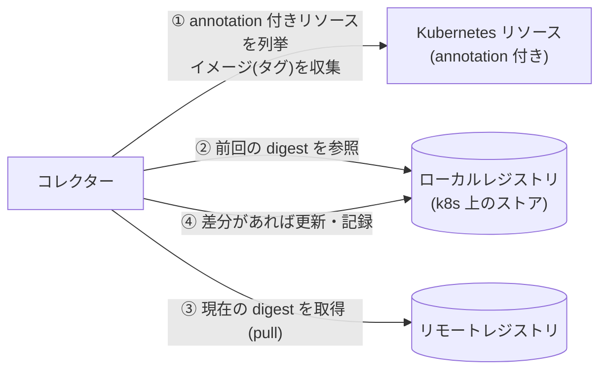
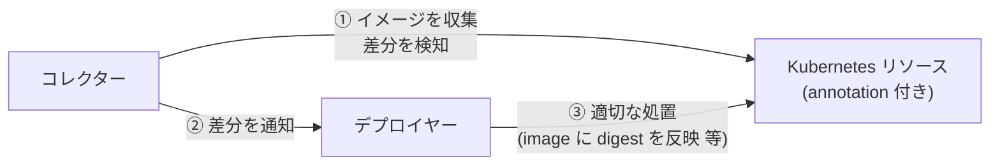

# kube-floatingtag-pinner

`latest` などの可変タグ（floating tag）が指す実体（digest）を追跡し、変化を検知して、
新しいイメージで動かし直すための仕組み。ラフスケッチ段階（詳細は [IDEA.md](./IDEA.md)）。

## 何を解決するか

- `image: xxx:latest` のままだと、レジストリ側が更新されても Kubernetes 側の spec は変わらず、
  新しいイメージが使われない（Knative は Revision 作成時に digest を固定するため特に顕著）。
- Deployment でも、Pod ごとに起動時期で digest がずれうる。
- そこで「タグが今どの digest を指しているか」を記録し、変わったら検知・反映する。

## 提供する機能

| 段階 | 機能 |
| --- | --- |
| 第一段階 | 収集・差分検知・取得（ワークロードは変更しない） |
| 第二段階 | 検知した差分に対する反映（デプロイヤー） |

### 登場人物

| 名前 | 役割 | 第一段階 | 第二段階 |
| --- | --- | :---: | :---: |
| リモートレジストリ | タグ → digest の正本（Docker Hub など） | ○ | |
| ローカルレジストリ | Kubernetes 上のストア（例: ConfigMap）。前回までのタグ → digest を保持 | ○ | |
| Kubernetes リソース | 所定の annotation が付いた Deployment / StatefulSet / DaemonSet / Knative Service。参照元 | ○ | ○ |
| コレクター | リソースからイメージを収集し、ローカルレジストリとの差分を検知、リモートレジストリから取得 | ○ | ○ |
| デプロイヤー | 検知した差分に対し適切な処置（spec の image に digest を書く等）を行う | | ○ |

> 第二段階ではリモートレジストリとの直接のやり取りは行わず、コレクターが検知した差分を入力とする。

## 概要図

### 第一段階: 収集と差分検知

### 第二段階: 反映

## 動作の流れ（第一段階）

1. コレクターが定期実行され、所定の annotation が付いたリソースを列挙する。
2. Pod テンプレートの `containers[]` / `initContainers[]` からイメージを取り出し、重複を除く。
3. ローカルレジストリに記録済みの digest と、リモートレジストリの現在の digest を比較する。
4. 変わっていれば差分として検知し、ローカルレジストリを更新する（イメージ・参照元・前後の digest を残す）。

## 既存ツールの対応状況

調べた範囲では、ksvc の `latest` 追従を満たす既存ツールは見つかっていない。実機で確認済みなのは Knative 本体のみ（下記）。

| ツール | Deployment 等 | ksvc | 備考 |
| --- | :---: | :---: | --- |
| Keel | ○ | ×（見込み） | `policy: force` + `matchTag` で可変タグの digest 変化を検知できるが、対象は標準ワークロードと Helm のみ |
| Knative 本体 | - | ×（実機で確認） | タグ解決は Revision 作成時の1回のみ。追従機能は無い |
| Argo CD Image Updater | △ | △ | `digest` 戦略 + `argocd` 書き戻しで、Helm / Kustomize のソースのみ更新可。導入済みだが未稼働のため未検証 |

### Keel（ksvc に使えるか）

結論: **ksvc には使えない見込み**（公式ドキュメント・ソースの範囲での確認。実機では未検証）。

- Keel の対象は Helm / DaemonSet / StatefulSet / Deployment。Knative Service の記載は見当たらない
  （[keel-hq/keel](https://github.com/keel-hq/keel)）。
- provider は `kubernetes`（標準ワークロードのみ）と `helm3` の2つで、Knative 用は無い
  （[provider/](https://github.com/keel-hq/keel/tree/master/provider)。一覧は表示上すべてとは限らない）。
- 可変タグ（`latest`）の追従は可能: `keel.sh/policy: force` + `keel.sh/matchTag: "true"` で、
  ポーリング時にマニフェストの digest を比較して検知できる。ただし更新先は上記の標準ワークロードに限られる。
- よって Deployment 等は Keel で足りる可能性があるが、ksvc は別手段が要る。
  「Deployment と ksvc を1つの仕組みに統一する」方針（IDEA.md 参照）の根拠が補強される。

### Knative 本体（`latest` 自動追従の有無）

結論: **Knative 本体に `latest` への自動追従は無い**（ソース・Issue に加え、実機でも確認）。

- 実機の検証結果: `app-authorization-demo` のイメージを更新して `latest` に push したが、
  `latest` を参照する ksvc は約20分経っても最新のイメージに更新されなかった（新 Revision もできない）。
  検証時は Argo CD Image Updater を動かしていない（Knative 本体のみの挙動）。
- 確認した値（2026-10-12）: `ghcr.io/sasano8/app-authorization-demo:latest` を参照する最新の Revision
  `app-authorization-demo-00007`（06:46 UTC 作成）の `status.containerStatuses[0].imageDigest` は
  `sha256:4a45bcf8…` のまま。レジストリ上の `latest` の現在の digest は `sha256:bf16c8e0…`
  （`docker buildx imagetools inspect` で取得）で、**一致しない**。
  Revision 00005 / 00006 / 00007 は、それぞれ作成時点の `latest` の digest（`fdb79066…` / `f84b09ad…` / `4a45bcf8…`）で
  固定されており、Revision を作った時にだけ解決される挙動とも合う。
- 最新 digest の確認: `crane digest <image>:latest`、または `docker buildx imagetools inspect <image>:latest`。
  Revision 側は `kubectl get revision -o custom-columns=NAME:.metadata.name,CREATED:.metadata.creationTimestamp,DIGEST:.status.containerStatuses[0].imageDigest`。

- タグ → digest の解決は、リゾルバが `remote.Head` を1回呼ぶだけ。ループ・タイマー・キャッシュ・watch は無く、
  タグが後で動いても追従しない
  （[resolve.go](https://github.com/knative/serving/blob/main/pkg/reconciler/revision/resolve.go)。
  呼び出し側が再解決するかは、このファイルだけでは判断できない）。
- Revision 作成時に digest へ解決し、`Revision.status.imageDigest` に入る。Revision は不変なので、
  `image:latest` に push しても既存 Revision は変わらず、新しい Revision を作るまで反映されない
  （[#12654](https://github.com/knative/serving/issues/12654)、[#12475](https://github.com/knative/serving/issues/12475)）。
  `imagePullPolicy: Always` でも解決済み digest が使われるため効かない。
- `registries-skipping-tag-resolving`（`config-deployment`）で解決を省くレジストリを指定できるが、
  追従させる機能ではなく、解決自体をやめる設定。image に digest を直接書いた場合も解決は省かれる。
- 公式ドキュメントに「追従しない」と明記したページは見つからなかった（knative.dev は取得できなかった）が、
  実機の結果と一致するため、仕様として扱ってよい。

## 未決事項

- annotation のキー名（IDEA.md では仮に `image-resolver/enabled: "true"`）。
- ローカルレジストリの実体（ConfigMap / CRD など）。
- 実装形態（最小は CronJob + `crane` + `kubectl`、必要に応じてコントローラ化）。
- Argo CD の `selfHeal` との折り合い（第二段階の実運用前に検討。IDEA.md 参照）。
