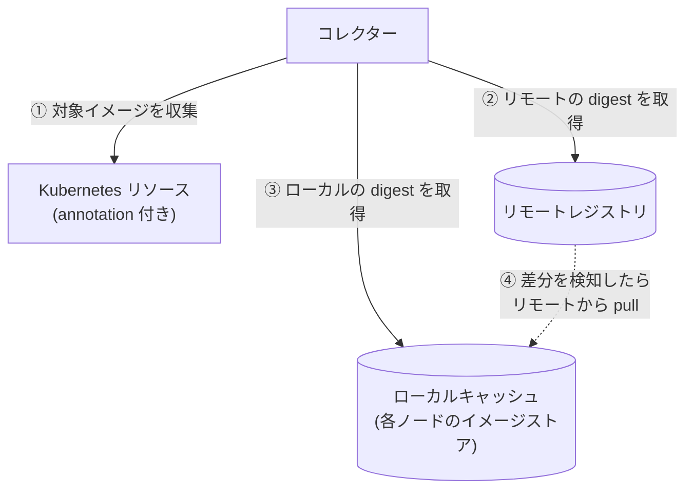
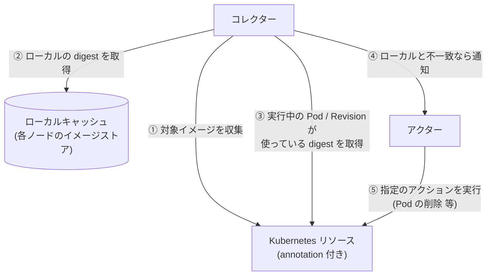

# kube-floatingtag-pinner

`latest` などの可変タグ（floating tag）が指す実体（digest）を追跡し、変化を検知して、
新しいイメージで動かし直すための仕組み。ラフスケッチ段階（詳細は [IDEA.md](./IDEA.md)）。

## 何を解決するか

- `image: xxx:latest` のままだと、レジストリ側が更新されても Kubernetes 側の spec は変わらず、
  新しいイメージが使われない（Knative は Revision 作成時に digest を固定するため特に顕著）。
- Deployment でも、Pod ごとに起動時期で digest がずれうる。
- そこで「タグが今どの digest を指しているか」を記録し、変わったら検知・反映する。

## 提供する機能

| 段階 | 機能 |
| --- | --- |
| 第一段階 | リモートを正に、ローカルキャッシュを同期する（収集・差分検知・pull。ワークロードは変更しない） |
| 第二段階 | ローカルキャッシュを正に、実行中のものが古ければ、指定のアクションを実行して追従させる（ベストエフォート。組み込みは再デプロイにつながるもの。spec の image は書き換えない） |

### 登場人物

| 名前 | 役割 | 第一段階 | 第二段階 |
| --- | --- | :---: | :---: |
| リモートレジストリ | タグ → digest の正本（Docker Hub など） | ○ | |
| ローカルキャッシュ | Kubernetes が pull して各ノードに保持しているイメージ（containerd 等のイメージストア）。Harbor のようなレジストリを建てるものではない。同期先に任意のレジストリを使う形も将来は想定 | ○ | ○ |
| Kubernetes リソース | 所定の annotation が付いた Deployment / StatefulSet / DaemonSet / Knative Service。参照元 | ○ | ○ |
| コレクター | 第一段階: リソースからイメージを収集し、リモートレジストリとローカルキャッシュを比較、差分があれば pull。第二段階: ローカルキャッシュの digest と、実行中の Pod / Revision の digest を比較し、差分を検知 | ○ | ○ |
| アクター（Actor） | 検知した差分に対して、リソースの annotation で指定されたアクション（Action）を実行する。組み込みは再デプロイにつながるもの（Deployment 等は Pod の削除や再ロールアウト、Knative は新 Revision の作成）。`none`（既定）は何もしない（見つけたことはログに出る） | | ○ |

> 第二段階ではリモートレジストリとの直接のやり取りは行わない。ローカルキャッシュの digest と、実行中の Pod の `imageID`（Knative は Revision の `imageDigest`）を比べ、不一致ならアクションを実行する。
> spec の image は書き換えない。

## 概要図

### 第一段階: 収集と差分検知（リモートとローカルの同期）

**リモートレジストリを正**にして、**ローカルキャッシュ**（各ノードのイメージストア）を同期する段階。
比べるのは、リモートの `latest` などのフローティングタグが指す digest と、ローカルの同じタグが指す digest。
差分があれば、リモートの内容でローカルを更新する（pull）。Kubernetes のリソースは、どのイメージを対象にするかを知るためだけに読み、
リソースが使っている digest は見ない。リソースには何もしない。



### 第二段階: 反映（ローカルとリソースの同期）

**ローカルキャッシュを正**にして、**Kubernetes のリソース**を同期する段階。第一段階でローカルは最新になっているので、
リモートレジストリは登場しない。比べるのは、ローカルのタグが指す digest と、実行中の Pod（Knative は Revision）が実際に使っている digest。
違っていれば、そのリソースに指定されたアクションを実行する。核は「リソースがローカルと違うことの検知」で、何をするかはアクション次第。
（違う digest が古いのか新しいのかは分からない。ローカルを正にするのは方針で、新旧の事実ではない。）
組み込みは、再デプロイにつながるもの（Pod の削除、Knative は新しい Revision の作成など）。spec の image は書き換えない。

各リソースが実際にどのイメージで起動するかは **ベストエフォート**で、Kubernetes の pull の仕組みの結果に任せる。
このツールは、アクション（組み込みは再デプロイ）で pull が起こるきっかけを作るだけで、起動するイメージを指定も保証もしない。
（再デプロイの間にリモートが進めば、ローカルより新しいイメージで起動することもある。）



## 動作の流れ（第一段階）

1. コレクターが実行され、所定の annotation が付いたリソースを列挙し、使っているイメージのうちフローティングタグ
   （既定は `latest`。タグ無しも `latest` 扱い）のものを集める。固定タグ（`v1.2.3` など）と digest 指定は無視する。
2. 各イメージについて、リモートレジストリでの、そのタグの現在の digest を取得する（イメージ本体は落とさない）。
3. ローカルキャッシュ（各ノードのイメージストア）で、同じタグが指している digest を取得して比較する。
   ノードに digest だけがあってタグが付いていないものは見ない（使われるときに勝手に pull されるため）。
   - ローカルのタグがリモートの digest を指している: 変化なし。
   - ローカルのタグが他の digest を指している（ノードごとに食い違う場合を含む）: 差分として検知し、
     リモートのタグを正としてローカルキャッシュを同期する（タグ指定で pull）。
   - ローカルがそのタグを持っていない（初見）: `--on-new` に従う。`register` は pull、`ignore` は何もしない。

digest を別に記録することはしない（正本はリモートのレジストリ、状態はローカルキャッシュ自身が持つ）。
実行中の Pod との突き合わせとアクションの実行は、第二段階で行う。

## コマンド（仮）

コマンドは段階ごとに分ける（段階ごとにリスクと必要な権限が違い、動かす間隔も別にできるため）。名前は仮で、再考の余地がある。

| コマンド | 内容 | 状態 |
| --- | --- | --- |
| `pinner pull` | 第一段階: リモートで変わったイメージを、ローカルキャッシュに pull する | 実装済み |
| `pinner trigger` | 第二段階: ローカルを正に、実行中のものがローカルと違えば、指定のアクションを引き起こす（結果はアクション次第で、保証しない） | 検知と `none` のみ実装済み |
| `pinner sync` | `pull` → `trigger` を続けて行う | 未実装 |

どのコマンドも、既定は 1 回実行して終了。`--daemon`（と `--interval`）で常駐して繰り返す。
第二段階はアクション（将来は Pod の削除など）の実行を伴うので、`pull` だけでは動かない。第二段階まで行うときは、`trigger` か `sync` を明示する。
アクション（`trigger` がリソースにすること）は、ログ（報告）とは別のもの。

- **ログ**: 見つけたことは、アクションと関係なく、常にすべて報告する。出す範囲は実行時のオプションで絞る（下の「ログ」）。
- **アクション**: リソースに何かをするもの。リソースの annotation で、状態ごとに指定する。**既定は `none`（何もしない）**。
  現状のアクションは `none` だけで、`delete-pods` などは未実装（指定するとエラーになる）。つまり、いまの `trigger` はリソースに何も変更しない。

| annotation | 意味 | 既定 |
| --- | --- | --- |
| `floatingtag-pinner/on-mismatch` | ローカルと違うときのアクション。**ふつうは、これだけ指定すればよい** | `none` |
| `floatingtag-pinner/on-not-pulled` | ローカルキャッシュがタグを持っていないときのアクション（任意） | `none` |
| `floatingtag-pinner/on-error` | 比較の途中で失敗したときのアクション（任意） | `none` |

- `match` と `not-running` には、アクションを結び付けない。
- `error` は、アクションにかかわらず、終了コードが非 0 になる。
- `on-not-pulled` は `on-mismatch` を引き継がない。比べる相手が無いので、何かを実行し続ける恐れがあるため
  （たとえば Knative は、Revision の Pod が digest で pull するので、ノードにタグが付かず、`not-pulled` のままになりうる）。
- `trigger --dry-run` は、アクションを実行せず、どのアクションが実行されるはずだったかをログに出す。

### ログ

`pull` も `trigger` も、見つけたことを、次の**状態**として報告する。名前は両方で共通。比べる相手だけが違う。

| 状態 | 第一段階（`pull`）: リモート ⇔ ローカル | 第二段階（`trigger`）: ローカル ⇔ 実行中 | ログレベル |
| --- | --- | --- | --- |
| `match` | ローカルのタグがリモートと同じ digest | 実行中の digest がローカルのタグと同じ | INFO |
| `mismatch` | ローカルのタグがリモートと違う digest（新旧は分からない） | 実行中の digest がローカルのタグと違う（新旧は分からない） | WARN |
| `not-pulled` | ローカルがそのタグを持っていない | 同じ | WARN |
| `not-running` | （なし） | 比べる相手（実行中の Pod / Revision の digest）が無い | INFO |
| `error` | 失敗（認証、タイムアウトなど） | 失敗（権限、取得の失敗など） | ERROR |

ログレベルは、状態ごとに固定（何もすることがない = INFO、違いがある = WARN、失敗 = ERROR）。

| オプション | 内容 | 既定 |
| --- | --- | --- |
| `--log-level` | ログレベルの下限（`debug` / `info` / `warn` / `error`） | `info` |
| `--log-states` | ログに出す状態（カンマ区切り。例: `mismatch,not-pulled,error`）。そのコマンドが出さない状態を指定するとエラー | すべて |

`--daemon` で `match` が毎回出てうるさいときは、`--log-level=warn` か `--log-states=mismatch,not-pulled,error` で絞れる。

ログの行は、報告した段階の接頭辞（`pull` / `trigger`）で始まる（`pull mismatch`、`trigger match` など）。
単体で実行しても、`sync`（`pull` → `trigger` を続けて実行）で実行しても、同じ形式になる。

状態の扱いは、段階で違う。

- **第一段階（`pull`）: 状態が変化する。** `pull` は pull を自分で行い、そのあとローカルのタグを読み直して確かめる。
  最初の状態と、pull したあとの状態を、続けて出す（`via=pulling`）。pull のあとも `mismatch` のままなら、そう出る
  （pull の間にタグがさらに進んだ、など）。ノードの状態の更新は遅れるので、読み直しは最大 30 秒、数秒おきに繰り返す。
- **第二段階（`trigger`）: 投げっぱなし。** 最初の状態を報告し、アクションを依頼する（`trigger action requested`）だけで、
  そのあと何が起きるかは Kubernetes の pull の仕組みに任せ、確かめない。結果は、次の実行で、新しい「最初の状態」として分かる。

`pull` の出力は、イメージごとに 1 行のログ（次は形式の例。実クラスタで取った出力ではない）。

```
level=INFO msg="pull match" image=ghcr.io/sasano8/app-authorization-demo:latest owners=[tutorial/Deployment/web] remote=sha256:bf16c8e0… local=[sha256:bf16c8e0…]

# 違いがあって pull した: 状態が変化する
level=WARN msg="pull mismatch" image=ghcr.io/sasano8/app-authorization-demo:latest owners=[app-authorization-demo/Service/app-authorization-demo] remote=sha256:bf16c8e0… local=[sha256:4a45bcf8…] outcome=pulled
level=INFO msg="pull match" image=ghcr.io/sasano8/app-authorization-demo:latest owners=[app-authorization-demo/Service/app-authorization-demo] remote=sha256:bf16c8e0… local=[sha256:bf16c8e0…] via=pulling

# --dry-run: 最初の状態だけ
level=WARN msg="pull mismatch" image=ghcr.io/sasano8/app-authorization-demo:latest owners=[…] remote=sha256:bf16c8e0… local=[sha256:4a45bcf8…] outcome=would-pull
```

`outcome` は、`pull` が違いに対してしたこと。

| `outcome` | 意味 |
| --- | --- |
| `pulled` | pull した（このあと、読み直した状態が続けて出る） |
| `would-pull` | `--dry-run` のため、pull が必要だったことだけを報告した |
| `ignored` | `not-pulled` で、`--on-new=ignore` のため、何もしなかった |
| `pull-failed` | pull に失敗した（`error` として報告され、終了コードは非 0） |

- 1 つでも失敗（認証、タイムアウトなど）があると、終了コードは非 0。

`trigger` の出力は、リソースとイメージごとに 1 行（これも形式の例）。

```
level=INFO msg="trigger match" resource=tutorial/Deployment/web image=ghcr.io/sasano8/app-authorization-demo:latest local=[sha256:bf16c8e0…]
level=WARN msg="trigger mismatch" resource=app-authorization-demo/Service/app-authorization-demo image=ghcr.io/sasano8/app-authorization-demo:latest running=revision=sha256:4a45bcf8… local=[sha256:bf16c8e0…]
level=WARN msg="trigger not-pulled" resource=tutorial/Deployment/proxy image=docker.io/library/nginx:latest hint="the local cache does not hold this tag (run pull first)"
level=INFO msg="trigger not-running" resource=tutorial/DaemonSet/agent image=ghcr.io/o/agent:latest hint="nothing to compare (scaled to zero, or no digest reported)"
```

状態の意味は上の表のとおり。`trigger` では、比べているのは、実行中の digest と、ローカルキャッシュ（ノードのイメージストア）のタグが指す digest。
`not-running` は、Pod が 0、Revision が未 ready、`imageID` に digest が無い、など。

- Pod は、その Pod が動くノードのタグと比べる。複数の Pod のうち 1 つでも違えば `mismatch`（違う Pod ごとに `running=` に出る）。
- Knative の Revision は、ローカル全体のタグと比べる。

| フラグ | 既定値 | 説明 |
| --- | --- | --- |
| `--local` | `node` | ローカルキャッシュの種類。現状は `node`（ノードのイメージストア）のみ |
| `--floating-tags` | `latest` | 追う（フローティング）タグ。カンマ区切り。これ以外のタグは固定とみなして無視。空なら全タグ |
| `--dry-run` | なし | 何も pull せず、pull が必要なものだけ報告する |
| `--on-new` | `register` | ローカルに何も無いイメージの扱い: `register`（pull）/ `ignore` |
| `--pull-namespace` | `default` | pull 用 Pod を作る名前空間 |
| `--pull-secret` | なし | 非公開レジストリ用の imagePullSecret 名（`--pull-namespace` 内） |
| `--pull-timeout` | `2m` | ノードごとの pull の待ち時間 |
| `--daemon` | なし | 常駐して `--interval` ごとに繰り返す。指定しなければ 1 回で終了 |
| `--interval` | `5m` | `--daemon` 時の実行間隔 |
| `--namespace` | 全て | 対象の名前空間 |
| `--annotation` | `floatingtag-pinner/enabled` | 対象を示す annotation（値 `"true"`） |
| `--kubeconfig` | in-cluster → `~/.kube/config` | |

対象は Deployment / StatefulSet / DaemonSet / Knative Service。`--floating-tags` 以外のタグと、`@sha256:` で固定済みのイメージは除く。

現状の制約:

- `node` の pull: Ready な各ノードに、そのノード固定（`nodeName`）の短命な Pod を作り、kubelet にタグ指定（`repo:latest` など、ワークロードと同じ参照）で pull させる。ノード上のタグが新しいイメージに付け替わり、
  あとで `IfNotPresent` の Pod が作られても新しいイメージで起動する。
  Pod のコマンドは存在しないものにしてあり、コンテナは動かない（pull だけが目的）。pull 完了後に Pod は削除する。
  必要な権限: Node の list、`--pull-namespace` での Pod の create / get / delete。
  ワークロードの spec は変更しない。
- ローカルキャッシュの読み取りは、呼ぶたびに Node を取得し直す（再スキャン）。結果をキャッシュして高速化する形は、`Local` を包む形で後から付け替えられる（現状は再スキャンのみ）。
- ノードの状態は `Node.status.images` から読む。kubelet の既定で1ノード最大50件、全ノードの和集合で判定する。

### 構成

```
cmd/pinner/          エントリポイント（段階ごとのコマンド。既定は1回実行、--daemon で常駐）
internal/collector/  収集と比較のロジック（実行形態に依存しない。Source / Registry / Local の interface）
internal/source/     Kubernetes リソースからイメージを集める
internal/registry/   リモートレジストリの digest 取得（go-containerregistry）
internal/local/      ローカルキャッシュ（ノードのイメージストアを読む実装）
```

設計の詳細（なぜそうしているか、採らなかった案、実機で未確認の前提）は [docs/design.md](./docs/design.md)。

## テスト

- **単体テスト**: `go test ./...`。Kubernetes のクライアントを偽物（fake）に差し替えているので、クラスタは要らない。CI（`main` への push）で実行される。
- **e2e テスト**（[test/e2e/run.sh](./test/e2e/run.sh)）: kind（本物の kubelet と containerd）と、CI の中のローカルレジストリで、
  `pull`（`--dry-run`、状態の変化、ログのオプション）と `trigger` を、本物のクラスタで確かめる。
  レジストリを自前で建てるので、タグを自由に動かせる（Docker Hub の rate limit にも依存しない）。
  - **いまはスキップされる**（[.github/workflows/e2e.yml](./.github/workflows/e2e.yml)）。リポジトリの変数 `RUN_E2E` を `true` にすると、
    `main` への push と pull request で動く。手動（Actions の `e2e` → Run workflow）でも、変数に関係なく実行できる。
  - 手元でも実行できる（docker、kind、kubectl が必要）: `go build -o pinner ./cmd/pinner && test/e2e/run.sh "$PWD/pinner"`。
  - まだ一度も実行していない。最初の実行で、スクリプトや想定の誤りが見つかる可能性がある。

## 既存ツールの対応状況

Keel・Knative 本体・Argo CD Image Updater では、ksvc の `latest` 追従を満たせないことを確認している
（Knative 本体は実機で確認）。詳細は [docs/research.md](./docs/research.md)。

## 未決事項

- コマンド名（`pull` / `trigger`）は決定。両方を続けて行う `sync` は仮。
- 第二段階のアクション（`delete-pods`、`restart`、`new-revision`）と `--dry-run` 以外の指定、`sync`。
- 任意のレジストリを同期先にする `--local`（`registry`）。
- Argo CD の `selfHeal` との折り合い（第二段階の実運用前に確認。[docs/design.md](./docs/design.md) 参照）。
