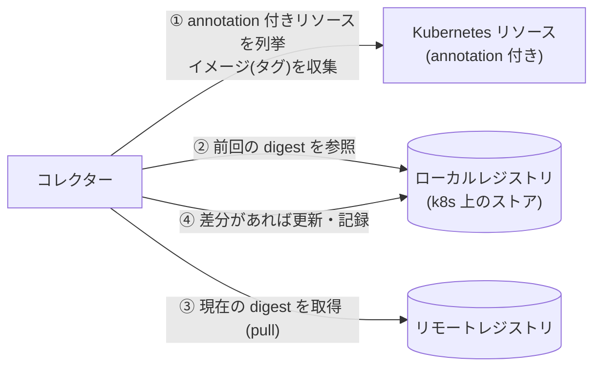
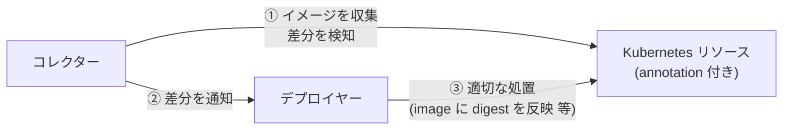

# kube-floatingtag-pinner

`latest` などの可変タグ（floating tag）が指す実体（digest）を追跡し、変化を検知して、
新しいイメージで動かし直すための仕組み。ラフスケッチ段階（詳細は [IDEA.md](./IDEA.md)）。

## 何を解決するか

- `image: xxx:latest` のままだと、レジストリ側が更新されても Kubernetes 側の spec は変わらず、
  新しいイメージが使われない（Knative は Revision 作成時に digest を固定するため特に顕著）。
- Deployment でも、Pod ごとに起動時期で digest がずれうる。
- そこで「タグが今どの digest を指しているか」を記録し、変わったら検知・反映する。

## 提供する機能

| 段階 | 機能 |
| --- | --- |
| 第一段階 | 収集・差分検知・取得（ワークロードは変更しない） |
| 第二段階 | 検知した差分に対する反映（デプロイヤー） |

### 登場人物

| 名前 | 役割 | 第一段階 | 第二段階 |
| --- | --- | :---: | :---: |
| リモートレジストリ | タグ → digest の正本（Docker Hub など） | ○ | |
| ローカルレジストリ | Kubernetes 上のストア（例: ConfigMap）。前回までのタグ → digest を保持 | ○ | |
| Kubernetes リソース | 所定の annotation が付いた Deployment / StatefulSet / DaemonSet / Knative Service。参照元 | ○ | ○ |
| コレクター | リソースからイメージを収集し、ローカルレジストリとの差分を検知、リモートレジストリから取得 | ○ | ○ |
| デプロイヤー | 検知した差分に対し適切な処置（spec の image に digest を書く等）を行う | | ○ |

> 第二段階ではリモートレジストリとの直接のやり取りは行わず、コレクターが検知した差分を入力とする。

## 概要図

### 第一段階: 収集と差分検知



### 第二段階: 反映



## 動作の流れ（第一段階）

1. コレクターが実行され、所定の annotation が付いたリソースを列挙し、使っているイメージ（タグ指定のもの）を集める。
   リソースが実際に使っている digest は見ない。
2. 各イメージについて、リモートレジストリの現在の digest を取得する（イメージ本体は落とさない）。
3. ローカルレジストリ（基準として確定している digest）と比較する。
   - 記録なし（初見）: `--on-new` に従う。`register` は基準として登録、`ignore` は何もしない。
   - 一致: 変化なし。
   - 不一致: 差分として検知し、ログに出して、ローカルレジストリを新しい digest に更新する。

リソースで実際に動いている digest との突き合わせは、第二段階（デプロイヤー）で行う。

## 使い方（最小実装）

```sh
# 対象にしたいリソースに annotation を付ける
kubectl annotate deployment/myapp floatingtag-pinner/enabled=true

go run ./cmd/pinner run --interval 5m        # 常駐して繰り返す
go run ./cmd/pinner once                     # 1回だけ（ローカルレジストリがメモリのため差分は出ない）
```

| フラグ | 既定値 | 説明 |
| --- | --- | --- |
| `--on-new` | `register` | 記録が無いイメージの扱い: `register` / `ignore` |
| `--interval` | `5m` | `run` の実行間隔 |
| `--namespace` | 全て | 対象の名前空間 |
| `--annotation` | `floatingtag-pinner/enabled` | 対象を示す annotation（値 `"true"`） |
| `--kubeconfig` | in-cluster → `~/.kube/config` | |

対象は Deployment / StatefulSet / DaemonSet / Knative Service。`@sha256:` で固定済みのイメージは除く。
ローカルレジストリは現状メモリのみ（再起動で消える）。ConfigMap 等への差し替えは `store` を入れ替えるだけでよい。

### 構成

```
cmd/pinner/          エントリポイント（once / run）
internal/collector/  収集と比較のロジック（実行形態に依存しない。Source / Registry / Store の interface）
internal/source/     Kubernetes リソースからイメージを集める
internal/registry/   リモートレジストリの digest 取得（go-containerregistry）
internal/store/      ローカルレジストリ（メモリ実装）
```

## 既存ツールの対応状況

Keel・Knative 本体・Argo CD Image Updater では、ksvc の `latest` 追従を満たせないことを確認している
（Knative 本体は実機で確認）。詳細は [docs/research/existing-tools.md](./docs/research/existing-tools.md)。

## 未決事項

- annotation のキー名（IDEA.md では仮に `image-resolver/enabled: "true"`）。
- ローカルレジストリの永続化（現状はメモリのみ。ConfigMap / CRD など。1 つの ConfigMap は約 1 MiB が上限）。
- すでに動いているリソースを初めて対象にしたとき、実際に動いている digest が基準と食い違う場合の扱い（第二段階で突き合わせる）。
- 実行形態の追加（CronJob 用のイメージ・マニフェスト、operator 化）。
- Argo CD の `selfHeal` との折り合い（第二段階の実運用前に検討。IDEA.md 参照）。
