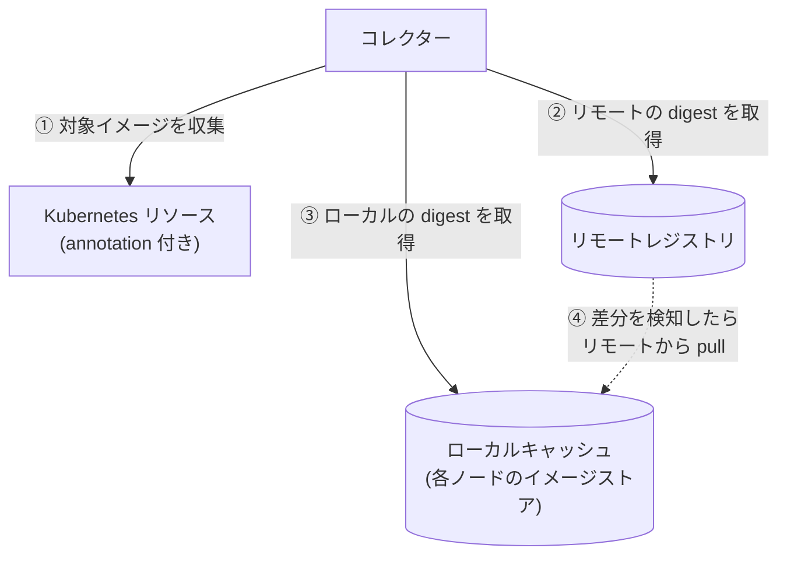
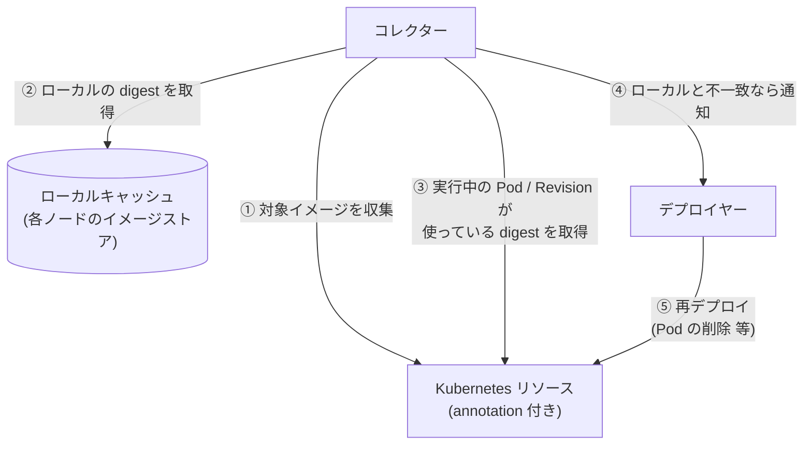

# kube-floatingtag-pinner

`latest` などの可変タグ（floating tag）が指す実体（digest）を追跡し、変化を検知して、
新しいイメージで動かし直すための仕組み。ラフスケッチ段階（詳細は [IDEA.md](./IDEA.md)）。

## 何を解決するか

- `image: xxx:latest` のままだと、レジストリ側が更新されても Kubernetes 側の spec は変わらず、
  新しいイメージが使われない（Knative は Revision 作成時に digest を固定するため特に顕著）。
- Deployment でも、Pod ごとに起動時期で digest がずれうる。
- そこで「タグが今どの digest を指しているか」を記録し、変わったら検知・反映する。

## 提供する機能

| 段階 | 機能 |
| --- | --- |
| 第一段階 | リモートを正に、ローカルキャッシュを同期する（収集・差分検知・pull。ワークロードは変更しない） |
| 第二段階 | ローカルキャッシュを正に、実行中のものが古ければ再デプロイして追従させる（ベストエフォート。デプロイヤー。spec の image は書き換えない） |

### 登場人物

| 名前 | 役割 | 第一段階 | 第二段階 |
| --- | --- | :---: | :---: |
| リモートレジストリ | タグ → digest の正本（Docker Hub など） | ○ | |
| ローカルキャッシュ | Kubernetes が pull して各ノードに保持しているイメージ（containerd 等のイメージストア）。Harbor のようなレジストリを建てるものではない。同期先に任意のレジストリを使う形も将来は想定 | ○ | ○ |
| Kubernetes リソース | 所定の annotation が付いた Deployment / StatefulSet / DaemonSet / Knative Service。参照元 | ○ | ○ |
| コレクター | 第一段階: リソースからイメージを収集し、リモートレジストリとローカルキャッシュを比較、差分があれば pull。第二段階: ローカルキャッシュの digest と、実行中の Pod / Revision の digest を比較し、差分を検知 | ○ | ○ |
| デプロイヤー | 検知した差分に対し再デプロイする（Deployment 等は Pod の削除、Knative は新 Revision の作成）。対象と操作は annotation で指定 | | ○ |

> 第二段階ではリモートレジストリとの直接のやり取りは行わない。ローカルキャッシュの digest と、実行中の Pod の `imageID`（Knative は Revision の `imageDigest`）を比べ、不一致なら再デプロイする。
> spec の image は書き換えない。

## 概要図

### 第一段階: 収集と差分検知（リモートとローカルの同期）

**リモートレジストリを正**にして、**ローカルキャッシュ**（各ノードのイメージストア）を同期する段階。
比べるのは、リモートの `latest` などのフローティングタグが指す digest と、ローカルの同じタグが指す digest。
差分があれば、リモートの内容でローカルを更新する（pull）。Kubernetes のリソースは、どのイメージを対象にするかを知るためだけに読み、
リソースが使っている digest は見ない。リソースには何もしない。



### 第二段階: 反映（ローカルとリソースの同期）

**ローカルキャッシュを正**にして、**Kubernetes のリソース**を同期する段階。第一段階でローカルは最新になっているので、
リモートレジストリは登場しない。比べるのは、ローカルのタグが指す digest と、実行中の Pod（Knative は Revision）が実際に使っている digest。
不一致なら、そのリソースを再デプロイする（Pod の削除、Knative は新しい Revision の作成など）。spec の image は書き換えない。

各リソースが実際にどのイメージで起動するかは **ベストエフォート**で、Kubernetes の pull の仕組みの結果に任せる。
このツールは、再デプロイして pull が起こるきっかけを作るだけで、起動するイメージを指定も保証もしない。
（再デプロイの間にリモートが進めば、ローカルより新しいイメージで起動することもある。）



## 動作の流れ（第一段階）

1. コレクターが実行され、所定の annotation が付いたリソースを列挙し、使っているイメージのうちフローティングタグ
   （既定は `latest`。タグ無しも `latest` 扱い）のものを集める。固定タグ（`v1.2.3` など）と digest 指定は無視する。
2. 各イメージについて、リモートレジストリでの、そのタグの現在の digest を取得する（イメージ本体は落とさない）。
3. ローカルキャッシュ（各ノードのイメージストア）で、同じタグが指している digest を取得して比較する。
   ノードに digest だけがあってタグが付いていないものは見ない（使われるときに勝手に pull されるため）。
   - ローカルのタグがリモートの digest を指している: 変化なし。
   - ローカルのタグが他の digest を指している（ノードごとに食い違う場合を含む）: 差分として検知し、
     リモートのタグを正としてローカルキャッシュを同期する（タグ指定で pull）。
   - ローカルがそのタグを持っていない（初見）: `--on-new` に従う。`register` は pull、`ignore` は何もしない。

digest を別に記録することはしない（正本はリモートのレジストリ、状態はローカルキャッシュ自身が持つ）。
実行中の Pod との突き合わせと再デプロイは、第二段階で行う。

## 使い方（最小実装）

```sh
# 対象にしたいリソースに annotation を付ける
kubectl annotate deployment/myapp floatingtag-pinner/enabled=true

go run ./cmd/pinner                          # 1回だけ実行して終了（既定）
go run ./cmd/pinner --daemon --interval 5m   # 常駐して繰り返す
```

| フラグ | 既定値 | 説明 |
| --- | --- | --- |
| `--local` | `node` | ローカルキャッシュの種類。現状は `node`（ノードのイメージストア）のみ |
| `--floating-tags` | `latest` | 追う（フローティング）タグ。カンマ区切り。これ以外のタグは固定とみなして無視。空なら全タグ |
| `--on-new` | `register` | ローカルに何も無いイメージの扱い: `register`（pull）/ `ignore` |
| `--pull-namespace` | `default` | pull 用 Pod を作る名前空間 |
| `--pull-secret` | なし | 非公開レジストリ用の imagePullSecret 名（`--pull-namespace` 内） |
| `--pull-timeout` | `2m` | ノードごとの pull の待ち時間 |
| `--daemon` | なし | 常駐して `--interval` ごとに繰り返す。指定しなければ 1 回で終了 |
| `--interval` | `5m` | `--daemon` 時の実行間隔 |
| `--namespace` | 全て | 対象の名前空間 |
| `--annotation` | `floatingtag-pinner/enabled` | 対象を示す annotation（値 `"true"`） |
| `--kubeconfig` | in-cluster → `~/.kube/config` | |

対象は Deployment / StatefulSet / DaemonSet / Knative Service。`--floating-tags` 以外のタグと、`@sha256:` で固定済みのイメージは除く。

現状の制約:

- `node` の pull: Ready な各ノードに、そのノード固定（`nodeName`）の短命な Pod を作り、kubelet にタグ指定（`repo:latest` など、ワークロードと同じ参照）で pull させる。ノード上のタグが新しいイメージに付け替わり、
  あとで `IfNotPresent` の Pod が作られても新しいイメージで起動する。
  Pod のコマンドは存在しないものにしてあり、コンテナは動かない（pull だけが目的）。pull 完了後に Pod は削除する。
  必要な権限: Node の list、`--pull-namespace` での Pod の create / get / delete。
  ワークロードの spec は変更しない。
- ローカルキャッシュの読み取りは、呼ぶたびに Node を取得し直す（再スキャン）。結果をキャッシュして高速化する形は、`Local` を包む形で後から付け替えられる（現状は再スキャンのみ）。
- ノードの状態は `Node.status.images` から読む。kubelet の既定で1ノード最大50件、全ノードの和集合で判定する。

### 構成

```
cmd/pinner/          エントリポイント（once / run）
internal/collector/  収集と比較のロジック（実行形態に依存しない。Source / Registry / Local の interface）
internal/source/     Kubernetes リソースからイメージを集める
internal/registry/   リモートレジストリの digest 取得（go-containerregistry）
internal/local/      ローカルキャッシュ（ノードのイメージストアを読む実装）
```

## 既存ツールの対応状況

Keel・Knative 本体・Argo CD Image Updater では、ksvc の `latest` 追従を満たせないことを確認している
（Knative 本体は実機で確認）。詳細は [docs/research/existing-tools.md](./docs/research/existing-tools.md)。

## 未決事項

- annotation のキー名（IDEA.md では仮に `image-resolver/enabled: "true"`）。
- 任意のレジストリを同期先にする `--local`（`registry`）。
- pull 用 Pod の RBAC と実行用マニフェスト（Dockerfile、CronJob / Deployment）。
- 実行形態の追加（CronJob 用のイメージ・マニフェスト、operator 化）。
- Argo CD の `selfHeal` との折り合い（第二段階の実運用前に検討。IDEA.md 参照）。
